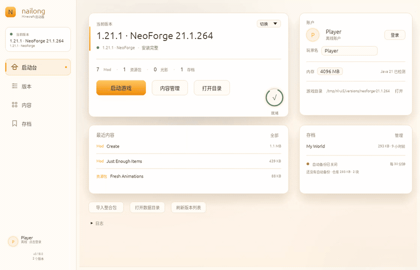
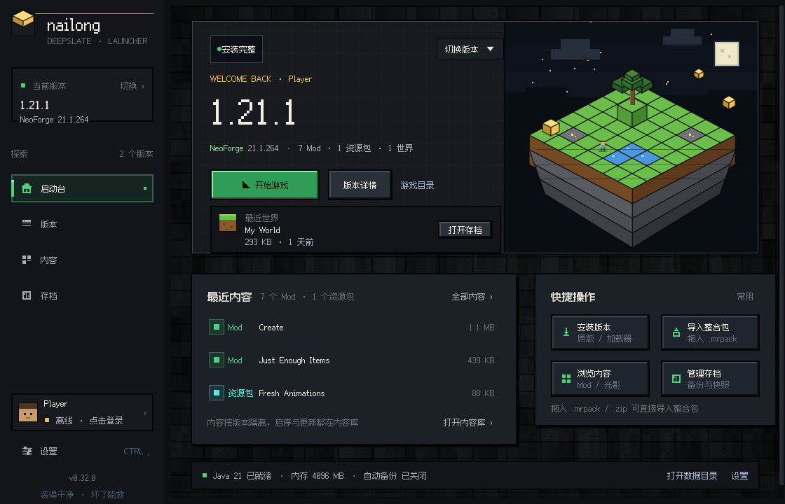
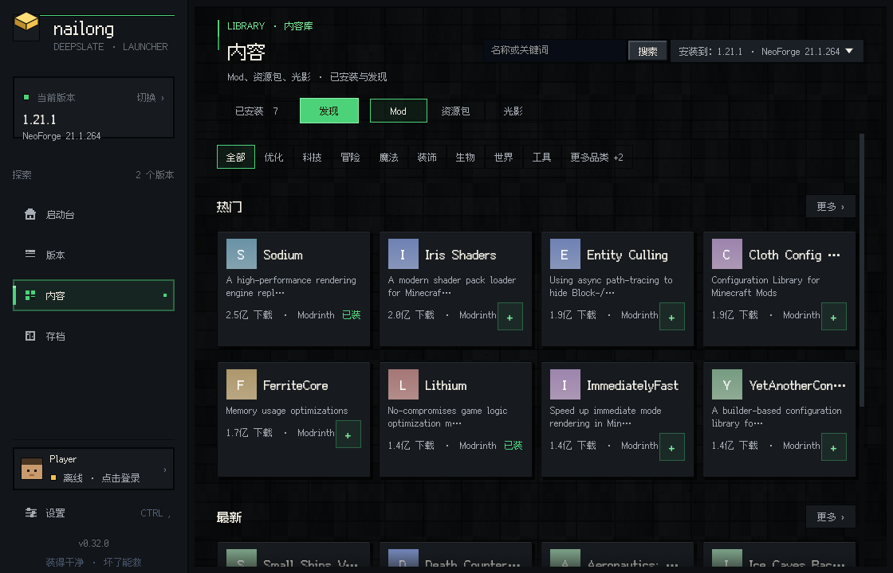
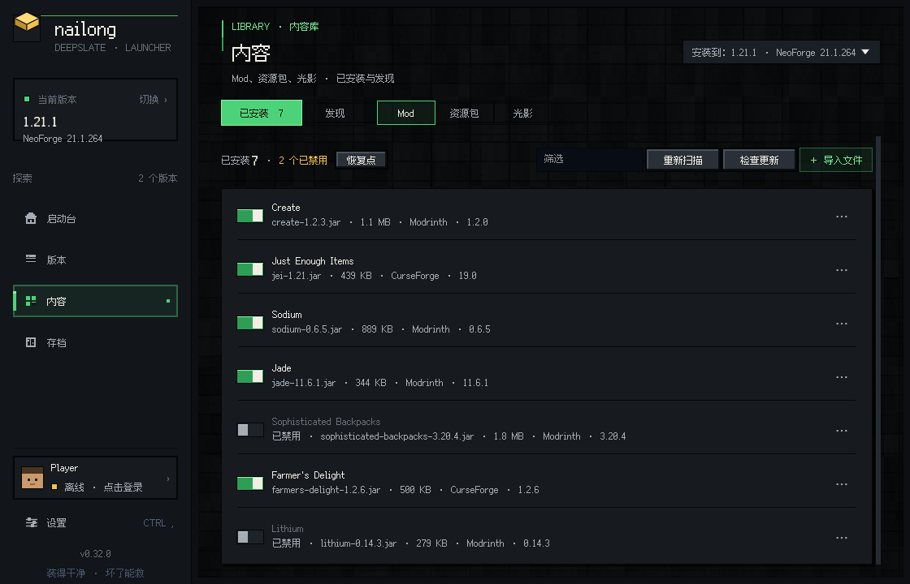
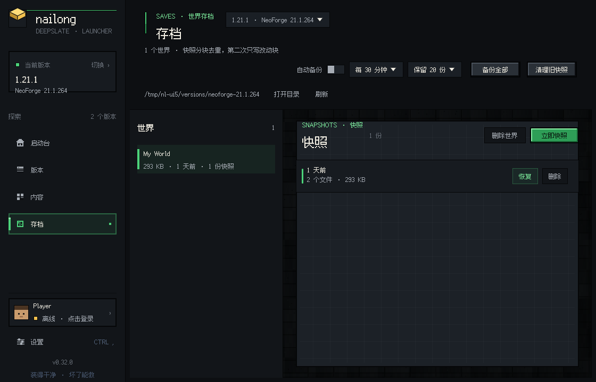

# nailong

[](https://github.com/dkjsiogu/nailong/actions/workflows/ci.yml)
[](https://github.com/dkjsiogu/nailong/releases/latest)
[](LICENSE)

A small, native Minecraft: Java Edition launcher written in Rust. Windows ships as a single executable, Linux as a single `.deb`. No bundled Java runtime, and no installer needed on Windows either.

[简体中文](README.md) | **English**

> Current version: **0.32.0** (preview)
>
> Goals: small binaries, few dependencies, visible install progress, and a repair path after interruption. See [implementation status](docs/design/14-implementation-status.md) for exact boundaries.

## Why nailong

Installing Minecraft is not the hard part — doing it cleanly is. Version JSON, asset indexes, loader processors, JVM flags, and a few hundred files per modpack: one mistake anywhere and the player just sees “launch failed”.

nailong tries to do one thing simply:

- Written in Rust; the launcher itself does not run on a JVM. One file on Windows, one package on Linux.
- Installation is split into visible stages; if interrupted, the next run checks what is missing and resumes instead of restarting.
- Forge/NeoForge client processors run directly — the official installer is never invoked or left on disk.
- Drop in a modpack and nailong detects the format, installs the loader, downloads files, and applies overrides.

It is not a universal launcher, and it is not 1.0 yet. What works and what does not is laid out below.

## Interface

0.32 tears out the 0.31 aurora glass and rebuilds the launcher in a Minecraft-native **Deepslate** pixel language: the bundled Fusion Pixel 12 px CJK face, zero rounded corners, two-pixel hard borders, beveled block buttons, pixel icons and a deepslate brick shell. Home's centrepiece is an isometric voxel island assembled block by block in Rust: grass, a tree, a pond, ore, a tiny explorer on the edge, four stepped dirt/stone layers and floating gold blocks. Every page and dialog uses the same block components; the four-column content grid is back at 1120 px, while 900×620 hides the latest-world slot and status strip and makes Settings scroll. The backdrop and island are generated per size and cached; idle CPU is still 0.0%.

0.31 replaces the whole interface with an aurora / dragon-ridge night sky: deep ink-blue glass, serif display type, and a Home that reads as one poster — the current version and Play on the left, the latest world floating on the right, recent content and shortcuts below. The backdrop and hero are not bundled images: they are generated in Rust once per size (aurora ribbons, star field, moon, dragon constellation, stepped ridges) and cached as textures, so the 0.30 idle-CPU result holds. The four-column content grid is back at 1120 px, and Settings becomes scrollable at the 900×620 minimum instead of clipping its content and Done button.

0.30 makes the ambient background static: gradients, dots and embers stay, but the window no longer redraws every 66 ms. On Xvfb + llvmpipe with the window focused, a five-second idle sample dropped from about 162% CPU for the process to 0%. This was the root cause of the “Home/page switch feels hot” reports.

0.29 adds Reduce Motion, persisted in `ui.json`: page fades complete immediately, ambient embers freeze, cards stop lifting, buttons stop shifting, progress sheen is disabled, switches snap, and idle ambient repaints stop. Colour and border feedback remain, so the UI does not feel broken when motion is off.

0.28 adds keyboard paths: Ctrl+1–4 switch Home/Versions/Content/Saves, Ctrl+, opens Settings, and F5 refreshes the version list. Shortcuts do not steal keys while a text field is focused or a dialog is open; the hint lives under Settings → Diagnostics.

0.27 tightens the Settings dialog: memory is a 1 GB `− 4 GB +` stepper instead of a raw DragValue, the Java row shows the actual detected version with Recheck and a Download Java 21 link when missing, and name/memory/Java now use two rows instead of one crowded line.

0.26 adds an update confirmation. “Update all” and a single row’s Update no longer overwrite files immediately: a checklist lists each project’s from → to version, the target instance, number of projects, download size, and notes that old files are cleaned up and a restore point is taken first. Updates and installs now share the same “look before writing” language.

0.25 unifies the controls that were still default egui: version stats now put a 20 px bold number above a small muted label, and Auto Backup / Show Base Versions use the same warm 36×20 switch as the content list instead of checkboxes. The Saves toolbar reads left-to-right as auto-backup → interval → keep → back up all → prune. No new features, just a quieter, more consistent page.

0.24 treats failure and dismissal as part of the interface. A failed login gets its own “login did not finish” result card with Retry and Close instead of dropping a raw AADSTS line behind the main window. Escape now closes Settings, Account, Restore Points, the login wait and the login-error card; content errors no longer expose raw URLs: an empty result shows a centered “content did not load” card with Reload, while a failed refresh keeps the list and adds a retry bar. Raw errors stay in the Settings log.

0.23 fixes the first rough edges players actually hit. On Windows the login URL is no longer opened through `cmd`, so a `&` in the query string can no longer truncate `scope` and trigger AADSTS900144. Cancelling the login dialog no longer poisons the content browser with a stale “operation cancelled”. Home/version statistics are cached per page instead of rescanned every frame, and the page transition is shortened from 260 ms to 180 ms. Content loading gets a skeleton card, browse/search results fit four columns at 1120 px, and login failures show one actionable sentence while raw AADSTS details go to the log.

0.22 makes restore points loader-aware: when content lives in an isolated version directory, the version JSON and patched client jar are stored with the point and restored exactly — the old patched jar is removed first, so rolling back to vanilla does not leave it behind. Reinstalling or repairing an existing loader takes a point first. Shared `libraries/` are not copied because old libraries are never deleted; world saves keep their own snapshot system, and custom external `gameDir` instances restore content only.

0.21 adds a confirmation step before anything is written: the card `+` and the detail-page install button now show project, target version, actual destination directory, version/file, size, dependencies and a restore-point note. Nothing downloads until you confirm, and cancelling writes nothing. First launch no longer drops you straight into the install form; it walks through **Java → game directory → install your first version or import a modpack** in one page.

0.20 makes “recoverable mistakes” real: every install, update, import or delete of mods/resource packs/shaders creates an instance **restore point** first. If something breaks, the Content page's restore-point dialog rolls back mods, configs, resource packs, shaders and the content index; it takes a safety point of the current state before restoring and verifies every object by SHA-1. Ten points are kept, whole files are deduplicated, and world saves remain on their own snapshot system.

0.19 turns Home from a dashboard into a play surface: **current version, one play action, version details, the latest world and recent content**. Account, player name, memory, Java, game/data folders and logs move into a sidebar Settings dialog; player name and memory persist in the data directory. The product thesis lives in the [product brief](docs/product/00-brief.md): **clean installs, recoverable mistakes**.

0.18 rearranges the UI around a player's daily path. A persistent sidebar holds four places — **Home, Versions, Content, Saves**. Content merges discovery and installed items into one library; Versions is only launch and maintenance; Saves is a first-class page with its own version picker. The theme is cream, white cards and orange/yellow accents. 0.18.1 adds a real bold CJK family, a matte amber primary action with optional play/download glyphs, and secondary buttons with warm borders and contact shadows.



| Home | Content · Discover |
|---|---|
|  |  |
| **Content · Installed** | **Saves** |
|  |  |

More screenshots (versions, install, search, detail, progress, first launch, settings, account and login, login failure, restore points, install confirmation, empty library, empty saves, plus six 900×620 narrow pages): [docs/screenshots](docs/screenshots). The 16-second clip covers sidebar navigation, Discover, detail and back, and Home.

## Features

### Install and launch

- Vanilla, Fabric, NeoForge, Forge — versions come from the official manifests, no manual entry.
- Native Forge/NeoForge install: we fetch only `install_profile`, `version.json`, and the client patch (~3 MB). The full installer is never kept.
- Once the version JSON is ready, assets, client/libraries, loader patches, and processors run in parallel where possible.
- Large files download in four ranged segments with resumable parts and automatic fallback to a mirror source.
- A machine-wide loader-patch cache; client/libraries use SHA1-addressed blobs and are hardlinked into place. Existing files only get a cheap size check.
- Patched clients found locally are reused: we scan official / PCL / HMCL / Prism / MultiMC / Modrinth and sibling `.minecraft` roots; a matching SHA1 (or a valid NeoForge JAR shape) skips the patch and processors.
- Reinstalling an intact Forge/NeoForge instance is a fast no-op — no re-download, no repeated processors.
- Missing assets show up as a specific “repair resources” action instead of a generic launch failure.
- Installs can be cancelled: downloads, extraction, and processors respond; completed parts stay on disk for the next repair/retry.

### Modpacks

Six formats are detected automatically:

| Format | Entry point | Notes |
|---|---|---|
| Modrinth | `.mrpack` | Direct URLs plus SHA1 |
| CurseForge | zip with `manifest.json` | Resolve project/file IDs; official builds include a key for SHA1 checks |
| Prism / MultiMC | `mmc-pack.json` | Components and overrides |
| MCBBS | `mcbbs.packmeta` | addons + files + overrides |
| HMCL | `modpack.json` + `minecraft/pack.json` | Embedded manifest becomes a profile |
| ATLauncher | `instance.json` | Embedded manifest becomes a profile |

Drag a `.mrpack` or `.zip` into the window to start an import. A single mod `.jar` is not treated as a modpack.

### Content library: discovery and installed

- **Content** in the sidebar is the only place for mods, resource packs and shaders. The “Installed / Discover” tabs are two modes of the same library, not two pages.
- Pick “install to: <installed version>” at the top right. Browsing and search then lock to that version's Minecraft version and loader, and `+` writes straight into its `mods/`, `resourcepacks/` or `shaderpacks/`.
- Prefer window-shopping? Choose “browse only”, pick any version/loader; cards still open their details, and `+` asks for an install target first.
- Content opens on **Installed**: counts, enable/disable switches, filtering, update checks, per-row/all updates and file import all live here. An empty library points straight at Discover.
- Switch to **Discover** for the browse page: title, search, content type and “install to” stay pinned at the top; the content area is a row of category chips (optimization, technology, adventure, realistic, fantasy, …) plus “Popular” and “Newest” shelves. No keyword required.
- Each card shows the icon, name, summary and download count, with a `+` in its bottom-right corner. It installs the latest build compatible with the selected version and loader, plus required dependencies, and then turns into “installed”.
- Clicking the rest of a card opens a two-column project page: project/version info and dependencies on the left, the install panel and version history on the right. Pick a file version and review `required` / `optional` / `incompatible` dependencies; `required` is added automatically, `optional` is off by default, `incompatible` blocks the download.
- Each shelf has “More ›” in its corner: it opens the full list for that shelf (24 per page) with “load more” pagination.
- Category chips come from **CurseForge's real category tree**: the launcher fetches `/v1/categories` at runtime and translates it, keeping CurseForge-only categories under their own names and appending Modrinth-only ones after them.
- Version and loader are optional: “all versions · all loaders” is the default, so window-shopping works without installing anything first.
- Cards show a short description (name, summary, downloads); the detail page has the full summary plus author and download count.
- The chip row shows 12 categories by default and folds the rest behind “more categories”. A source switch (All / Modrinth / CurseForge) lets you browse the CurseForge catalogue as-is, with its categories and sort orders. Downloads are still resolved and verified by the launcher; no website is involved.
- Search stays in the top bar (Enter to run) and renders the same cards with pagination.
- Files go into that version's `mods/`, `resourcepacks/` or `shaderpacks/`. A normal version gets an isolated `gameDir` (`versions/<id>/`) on first download; existing saves in the root are not migrated.
- **Installed** mode is the content manager: filter by name, toggle files, check for updates, update one or all, and see duplicate warnings. Delete asks inline from the `⋯` menu, and updating a disabled file keeps it disabled.
- **Install confirmation**: the card `+` and detail install both show target, destination directory, version/file, size, dependencies and the restore-point note before anything is written; cancelling leaves disk untouched.
- **Restore points**: created automatically before content installs, updates, imports, deletes and loader reinstalls; the Content page's restore-point dialog can create, restore or delete points. In isolated instances the version JSON and patched client jar are stored too. Restoring takes a safety point first and verifies every stored object by SHA-1. A failed point creation aborts the operation instead of continuing silently.
- Local `.jar` drag/import is supported, as is local `.zip` import for resource packs and shaders.
- Identical existing files are skipped; conflicts are reported, never silently overwritten. Updates replace the old version and keep the index in sync.

### Everyday use

- Microsoft account login from the account chip at the bottom of the sidebar: browser authorization code + PKCE on a loopback port, automatic token refresh, and `--accessToken` / `--uuid` / `--xuid` at launch.
- Tokens live in `account.json` under the data directory (mode 0600 on Unix) and never appear in logs; logging out deletes it.
- Offline-account launch (singleplayer / LAN) still works when nobody is signed in.
- Settings: the sidebar footer opens one dialog for player name, memory, Java status, game/data folders and logs; player name and memory persist in `ui.json`.
- Versions: base versions required by a loader are hidden from the main picker and protected from deletion; this page only launches, repairs, reveals the folder and deletes. Content and saves live in their own sidebar places.
- Saves: a first-class page with a version picker at the top; list worlds with size and modified time. Backups are **git-style snapshots**: content-defined chunking stores only changed chunks, so a second backup usually adds a few MB; restore, delete and prune by count.
- Automatic backups: every 15/30/60/120 minutes, keeping 5/10/20/50 snapshots per world; settings live in `backups.json` under the data directory and run while the launcher is open.
- Resource packs and shaders get the same enable/disable, delete, file-size and open-folder affordances as mods.
- Install progress: stage, percentage, downloaded / total bytes, and file count.
- GUI and CLI share the same core; the CLI is useful for scripts and debugging.

## Download

| Platform | File | Size | Requirements |
|---|---|---:|---|
| Windows x64 | [nailong.exe](https://github.com/dkjsiogu/nailong/releases/latest/download/nailong.exe) | ~16 MB | Windows 10/11, Java 21 |
| Linux x64 (deb) | [nailong_0.32.0_amd64.deb](https://github.com/dkjsiogu/nailong/releases/latest/download/nailong_0.32.0_amd64.deb) | ~4.8 MB | Ubuntu 24.04+ / glibc ≥ 2.39, Java 21 |

Checksums: [SHA256SUMS](https://github.com/dkjsiogu/nailong/releases/latest/download/SHA256SUMS).

### Windows

1. Download `nailong.exe`, put it anywhere, and double-click it.
2. The first screen is the setup page: choose a Minecraft version, then Fabric / NeoForge / Forge / vanilla, and click **Install**.
3. When the progress finishes, return to the main screen and click **Launch**.

Java 21 must be installed. nailong searches for it automatically and shows a warning if none is found.

> The executable is not code-signed, so SmartScreen may show “Unknown publisher”. Choose **More info → Run anyway**. Antivirus false positives can also happen.

### Linux (Debian / Ubuntu)

```bash
sudo apt install ./nailong_0.32.0_amd64.deb
nailong
```

You can also double-click the deb in a software center. After installation, **nailong** appears in the application menu.

Uninstall:

```bash
sudo apt remove nailong
```

> The deb is built on Ubuntu 26.04 / amd64 and requires glibc ≥ 2.39. Ubuntu 24.04+ works; older systems such as 22.04 cannot install it yet.

### Data directory

- Windows: `.minecraft` next to `nailong.exe` (portable).
- Linux: `~/.local/share/nailong/.minecraft`.

Use `--root` to point at another directory.

## CurseForge API (built in)

Official releases include a project key, so CurseForge packs use the official API automatically and **regular users do not configure anything**. It is an application-level key, not a CurseForge account password.

- The official API returns the file name, size, SHA1, and download URL, so downloads can be verified.
- If the author has disabled third-party distribution, the import stops and lists the affected files. nailong does not synthesize CDN URLs to bypass that setting.
- Maintainers can override the built-in key with the `CURSEFORGE_API_KEY` environment variable, so rotating it does not require a code change.
- The key is lightly XOR-obfuscated so a casual `strings` scan does not reveal it. **This is not encryption**: it can still be recovered from the binary and is only a shared default quota, not a secret.
- A local build without an injected key still imports packs through the no-key cfwidget + official-page fallback, without official SHA1.

## What has been verified

Ran for real:

- GUI: every page was walked at 1120×720 and the 900×620 minimum, including first launch, install confirmation, browse/search/detail, content manager, empty states, save snapshots, the settings dialog, content restore points, progress, and the account/login dialogs; 24 screenshots (18 at 1120×720 and 6 at 900×620) and a 16-second motion GIF live in `docs/screenshots/`. The 0.32 pass re-measured idle CPU at 0.0% with the window focused and the pointer parked.
- Linux (Xvfb + Mesa): Fabric 0.19.5, NeoForge 21.1.209, and Forge 52.1.20 on 1.21.1 reached the main menu.
- Fabulously Optimized `.mrpack`: 151 mods loaded and launched.
- CurseForge: a real file was downloaded through the no-key official-page fallback; the approved API key returned the official file name, size, SHA1, and download URL.
- GUI cancellation: cancelled an install under Xvfb and returned to the “continue install” page without crashing.
- Content library: real Modrinth + CurseForge APIs; mod/resource-pack/shader search; Jade plus its required dependency downloaded into the version-isolated `mods/`; installed scan, toggles, duplicate detection and update checks. 0.10.0 adds a real click-through test: the `+` button on a browse card downloaded Fabric API into the isolated `mods/` and wrote the content index.
- Prism, MCBBS, HMCL, and ATLauncher: real or synthetic samples passed format detection and instance creation.

Not verified yet:

- Windows is built natively in CI but has not been launched on a real Windows machine.
- macOS is not supported.

## Command line

The deb only contains the GUI; building from source also produces the CLI:

```bash
./target/release/nailong --root /path/to/.minecraft list
./target/release/nailong --root /path/to/.minecraft install neoforge 1.21.1 21.1.209
./target/release/nailong --root /path/to/.minecraft install modpack ~/Downloads/pack.mrpack
./target/release/nailong --root /path/to/.minecraft install modpack ~/Downloads/pack.zip
./target/release/nailong --root /path/to/.minecraft launch neoforge-21.1.209 --username Steve --memory 4096
```

## Build from source

Rust 1.95+ is required. On Linux, egui also needs system development packages:

```bash
sudo apt install build-essential pkg-config \
  libgl1-mesa-dev libegl1-mesa-dev \
  libx11-dev libxext-dev libxcursor-dev libxi-dev libxrandr-dev \
  libxkbcommon-dev libxkbcommon-x11-dev
```

Build the GUI and CLI:

```bash
cargo build --release -p nailong-ui -p nailong-cli
```

Build the Linux deb:

```bash
./scripts/build-deb.sh
# output: dist/nailong_<version>_<arch>.deb
```

Windows release builds use MSVC with the static CRT in GitHub Actions. `x86_64-pc-windows-gnu` can also be used for a local cross-compile check.

> Building from source without `NAILONG_CURSEFORGE_API_KEY` produces a binary with the **CurseForge source disabled** (Modrinth is unaffected). This is intentional: the key is obfuscated into the binary at build time and never read from a config file.
>
> ```bash
> NAILONG_CURSEFORGE_API_KEY=... cargo build --release -p nailong-ui
> ```
>
> Live network smoke tests (ignored by default):
>
> ```bash
> cargo test -p nailong-core --test live_modrinth -- --ignored --nocapture
> ```

## Not implemented yet

- Microsoft tokens are stored in a 0600 file instead of the OS keychain (Credential Manager / Secret Service).
- Launcher self-update, skins, and full modpack updates.
- Stopping a running game / cancelling a launch.
- Real Windows testing and macOS support.

## Project layout

```text
crates/
  nailong-core/   manifests, downloads, Java detection, launch, loaders, modpacks, content center
  nailong-cli/    command line
  nailong-ui/     egui desktop UI
packaging/linux/  desktop file, icons, AppStream metadata, copyright
scripts/          deb packaging
docs/
  design/         architecture and design notes
  brief/          9-page project brief
```

See the [design index](docs/design/00-overview.md) and the [implementation status](docs/design/14-implementation-status.md).

## License

GPL-3.0-or-later. See [LICENSE](LICENSE).

This project is not affiliated with Mojang Studios or Microsoft, and it does not bundle or redistribute Minecraft game assets.
