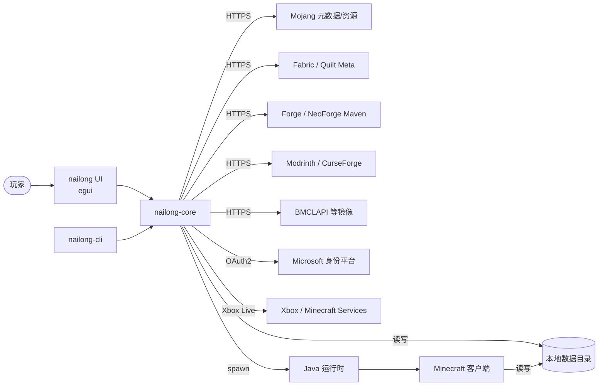
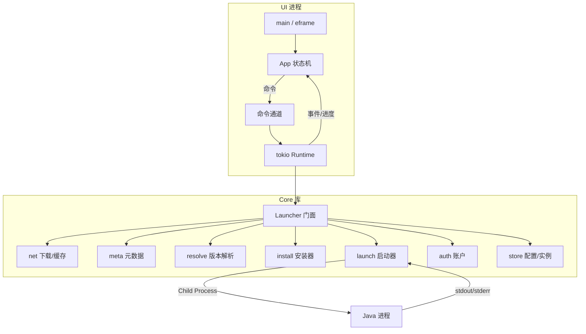

# 00 · 总览

> 状态：设计稿 v0.3（2026-10-20）
> 范围：产品定位、目标与非目标、量化指标、系统上下文、关键决策索引。
> 原型进度：**0.1.0 垂直切片已跑通**（安装并启动 NeoForge 1.21.1），与设计稿的偏差见 [14 实现状态](14-implementation-status.md)。

## 0. 已确认（2026-10-20）

| 决策 | 结果 |
|---|---|
| 许可证 | **GPL-3.0-or-later**（可合法移植 Prism/HMCL 的 GPL 代码） |
| 微软登录 | **推迟到 M3.5**；v1.0 先交付离线账户，client id/allowlist 不阻塞 |
| 项目名 | **nailong**，由作者本人使用；素材仍需原创或合规 |
| M0 范围 | 解析 + 启动已有 `.minecraft`；契约见 [11](11-m0-contract.md) |
| 首个可运行版 | 0.1.0：Windows/Linux 安装 NeoForge 1.21.1 并离线启动；状态见 [14](14-implementation-status.md) |

## 1. 产品定位

**nailong 是一个"轻量优先"的 Minecraft: Java Edition 启动器。**

它不试图复刻 HMCL 的全部功能，也不追求 Prism 的模组生态深度。它要解决三件具体的事：

1. **开箱即用**：下载一个 10 MB 左右的单文件，双击即可；不需要预装 Java（首次启动按需下载托管 JRE），也不依赖 .NET、Qt、WebView2。
2. **启动可靠**：能正确启动 1.7.10 到 2026 年最新版本（当前 `26.3`），正确处理 Forge processors、natives、资源索引、Java 版本与微软登录。
3. **对国内网络友好**：默认自动选择镜像、并发下载、断点续传、内容校验；失败可解释、可重试。

一句话：**把"启动游戏"这条路径做到又轻又稳，其他功能围绕它生长。**

### 1.1 目标用户

| 用户 | 需求 | nailong 的回应 |
|---|---|---|
| 轻度玩家 | 装个版本、加 Fabric、点开始 | 三步向导；默认配置合理；不暴露 JVM 参数 |
| 模组玩家 | 多实例隔离、Forge/Fabric、整合包 | 实例隔离；加载器安装；mrpack/CurseForge 导入 |
| 多版本玩家 | 1.7.10 / 1.12.2 / 1.20.1 / 最新版共存 | 共享 libraries/assets，实例级 game dir |
| 低配/老机器用户 | 启动器本身不要吃内存 | 原生 GUI，目标空闲 < 120 MB |
| 国内用户 | 下载慢、GitHub 不稳 | BMCLAPI 等镜像、候选 URL、断点续传 |

### 1.2 非目标（v1 不做）

- 不内置游戏本体、不绕过正版验证、不提供盗版下载。
- 不做服务端管理、联机大厅、皮肤站运营。
- 不做完整的 Modrinth/CurseForge 内容平台；当前做按版本锁定的 Mod/资源包/光影检索、下载、依赖解析和基础已安装管理。
- 不做 OptiFine / LiteLoader 自动安装（可在 v2 评估；它们需要改 jar 或额外 patch）。
- 不做 macOS 公证、Windows 商店上架（工程上可行，但需要账号与预算）。
- 不做插件系统 / 脚本 API（避免把核心复杂度提前引入）。

## 2. 量化指标

"轻量"必须可测量，否则只是口号。以下为 v1.0 的验收目标，括号内为实现预算。

| 指标 | 目标 | 测量方法 |
|---|---|---|
| Windows x64 发布物 | 单 exe **≤ 15 MB**（zip ≤ 10 MB） | `cargo build --release` 后 `strip`，资源管理器查看 |
| Linux x64 发布物 | 单二进制 **≤ 18 MB**（含 glibc 动态依赖） | 同上 |
| 冷启动到首帧 | **≤ 400 ms**（SSD，无网络等待） | 启动打点：`main` → 第一帧 `update()` |
| 空闲内存（实例列表 20 个） | **≤ 120 MB RSS**，目标 60–80 MB | Windows 任务管理器 / `ps_mem`，静置 60 s |
| 下载时 UI 帧率 | 稳定 60 FPS，单帧阻塞 **< 16 ms** | egui 帧时间面板 + `tracing` 慢帧告警 |
| 从零安装 1.20.1 | 100 Mbps 下 **≤ 4 min**（网络为瓶颈） | 端到端计时 |
| 启动器自身 CPU（空闲） | **< 1%**（单核） | 静置采样 |
| 崩溃率 | 会话崩溃 **< 0.5%** | 本地匿名计数（默认关闭，需显式同意） |
| 安装可恢复 | 任意阶段断电/取消后，再次安装能续传或修复 | 集成测试注入中断 |

> 注：HMCL / Prism 的实际内存与启动时间依平台与版本差异很大，本设计不引用未经验证的数字作为对比，只设定自己的预算并持续测量。竞品定性对比见 [01 先行研究](01-prior-art.md)。
> 初始基线（Linux + Xvfb + llvmpipe 的 egui 空窗口）：5.15 MiB / 36–40 ms / 107 MiB（软件渲染上界）。Windows 真实 GPU 预计更低；M0 复测，详见 [GUI 基线](../bench/gui-2026-10.md)。

## 3. 支持矩阵

### 3.1 平台（v1）

| 平台 | 架构 | 优先级 | 说明 |
|---|---|---|---|
| Windows 10/11 | x86_64 | **P0** | 主力平台；无控制台窗口；原生文件对话框 |
| Windows 10/11 | aarch64 | P2 | Mojang 提供 ARM64 JRE；UI 需验证 OpenGL/DX 驱动，必要时 wgpu/WARP 回退 |
| Linux | x86_64 | P1 | X11/Wayland；`.desktop` + AppImage/tar.gz |
| macOS | x86_64 / aarch64 | P2 | `.app`；未公证时需右键打开；`-XstartOnFirstThread` |
| Windows 7/8 | x86_64 | 不承诺 | egui/wgpu 可能可用，但不做兼容测试 |

### 3.2 游戏版本

- 正式版：**1.7.10 – 26.3**（含 2026 年起的日期式版本号）。
- 快照：可选显示；解析逻辑与正式版一致，但 UI 默认折叠。
- 更老版本（≤1.6.4）：设计上支持 legacy assets / 旧启动参数，v1 不承诺；留作 v2。
- 版本号**不做语义化假设**：一律按字符串 ID + `releaseTime` 排序，兼容 `26.3`、`1.21.11`、`23w31a` 等任意 ID。

### 3.3 模组加载器

| 加载器 | v1 | 实现方式 |
|---|---|---|
| Fabric | ✅ | meta profile JSON + 库下载 |
| Quilt | ✅ | meta profile JSON + 库下载 |
| Forge（1.13+） | ✅ | installer `install_profile.json` processors |
| NeoForge | ✅ | 同 Forge（不同 maven/主类） |
| Forge（≤1.12.2） | ✅ | 旧版 installer（`versionInfo` + `install`） |
| OptiFine / LiteLoader | ❌ v2 | 需要 jar patch / tweaker |

### 3.4 账户

- 微软账户（OAuth2 授权码 + PKCE；设备码兜底）——**v1.1 / 待 client id allowlist，不阻塞 v1.0**。设计见 [07](07-auth-accounts.md#21-应用注册准备上线正版登录时)。
- 离线账户（合法用于本地/局域网）。
- authlib-injector 外置登录（v1.1）。
- 多账户切换、令牌刷新、皮肤头像（2D）缓存。

## 4. 架构原则

1. **核心与界面解耦**：`nailong-core` 不依赖任何 GUI 框架，可被 CLI、测试、未来的服务端复用。
2. **计划与执行分离**：先把"要做什么"算成一个纯数据的 `Plan`（启动计划 / 安装计划），再执行。计划可快照、可对比、可测试。
3. **不可变模型 + 保留原始 JSON**：版本 JSON 的已知字段强类型化，未知字段原样保留；写回不丢信息，兼容第三方启动器与未来字段。
4. **数据驱动，而非继承体系**：镜像 = URL 重写规则表；加载器 = 安装器注册表；整合包 = 格式探测器。新增一种源/格式只加数据或一个小实现。
5. **一切网络操作可取消、可重试、可解释**：候选 URL、指数退避、断点续传、哈希校验、错误码。
6. **UI 永不阻塞**：所有 IO 在 tokio 任务中；UI 只消费事件与快照。
7. **默认安全**：不执行 shell；路径穿越防护；令牌脱敏；HTTPS 优先；下载内容校验。
8. **可测量的轻量**：每个版本在 CI 中记录二进制大小与启动时间，回归即报警。

## 5. 系统上下文

### 5.1 运行时容器

## 6. 关键决策摘要

| # | 决策 | 选择 | 理由 | 详见 |
|---|---|---|---|---|
| D1 | GUI | **egui/eframe** | 纯 Rust、单二进制、内存与体积可控、跨平台 | [02](02-tech-stack.md#2-gui-选型) |
| D2 | 核心组织 | **一个 `nailong-core` crate + 明确模块边界** | 小团队编译快；过早拆 crate 增加样板 | [03](03-architecture.md#2-workspace-与依赖方向) |
| D3 | 版本来源 | **官方 profile JSON + inheritsFrom 链**（非自研 patch 格式） | 与官方/Prism/MultiMC 互操作；加载器安装器天然产出这种格式 | [04](04-version-model.md#5-加载器-profile) |
| D4 | 下载 | **自研候选 URL 下载器 + 两级缓存** | 镜像切换、续传、校验、并发都可控 | [06](06-install-download.md) |
| D5 | Java | **优先 Mojang 官方运行时，系统 JDK 兜底** | 与游戏版本严格匹配；无需第三方 API key | [06](06-install-download.md#7-java-运行时管理) |
| D6 | Forge | **原生 processors + 按需读取安装数据，完整安装包仅兼容兜底** | 可控进度/镜像；只取约 3 MB 核心数据；处理器依赖完整包时自动回退 | [06](06-install-download.md#6-加载器安装)、[14](14-implementation-status.md) |
| D7 | 认证 | **授权码 + PKCE（loopback）为主，设备码兜底** | 体验好；无需 client secret | [07](07-auth-accounts.md) |
| D8 | 存储 | **TOML 配置 + JSON 版本文件 + 文件系统，无数据库** | 轻量、可手工修复、易迁移 | [04](04-version-model.md#2-磁盘布局) |
| D9 | 错误 | **thiserror 类型化错误 + 稳定错误码 + i18n key** | UI 可解释；日志可检索；测试可断言 | [03](03-architecture.md#5-错误模型) |
| D10 | 许可 | **GPL-3.0-or-later（已定）** | 与 Prism/HMCL 生态一致，可合法移植 GPL 代码 | [09](09-security-legal.md#8-许可证与洁净室) |

## 7. 关键约束与风险

| 约束/风险 | 影响 | 缓解 |
|---|---|---|
| 微软 Azure 应用需自有 client id，且 Minecraft Services 需 **allowlist 审批** | 未获批时 `login_with_xbox` 返回 403 | **不阻塞 v1.0**：先交付离线账户；正版登录作为 v1.1 能力，client id/审批后置 |
| Forge processors 复杂且随版本变化 | 安装失败率高 | 原生实现 + 真实 installer 集成测试 + 外部 installer 兜底 |
| 2026 年起版本号/参数格式变化（26.x） | 硬编码会失效 | 一切以 version JSON 为准；`default-user-jvm`、natives 子目录等已纳入设计（附录 A） |
| 国内镜像可用性波动 | 下载失败 | 多候选 + 官方兜底 + 用户可自定义 |
| PCL 受限许可证 | 不能复制其代码/资源 | 仅研究行为；GPLv3 项目可使用 Prism/HMCL 代码（见 09） |
| macOS 公证 / Windows 签名 | 用户安装警告 | v1 文档说明；后续购买证书 |

## 8. 术语

| 术语 | 含义 |
|---|---|
| **Instance（实例）** | 一个可启动的配置单元：版本 + 加载器 + 游戏目录 + Java/内存设置 |
| **Manifest / Version JSON** | Mojang 或加载器提供的版本描述文件 |
| **Profile** | 落盘的 manifest（`shared/versions/<id>/<id>.json`），可含 `inheritsFrom` |
| **Resolve（解析）** | 沿 `inheritsFrom` 合并成一份扁平 manifest 的过程 |
| **LaunchPlan** | 纯数据的启动计划：Java、JVM 参数、主类、游戏参数、classpath、natives、工作目录 |
| **RunDir** | 传给 `--gameDir` 的游戏工作目录（共享 / 实例 / 自定义） |
| **Content cache** | 以哈希寻址的下载缓存 |
| **Mirror rule** | 把官方 URL 前缀重写为镜像前缀的规则 |
| **Loader profile** | Fabric/Quilt/Forge/NeoForge 安装后生成的、继承原版的 profile |
