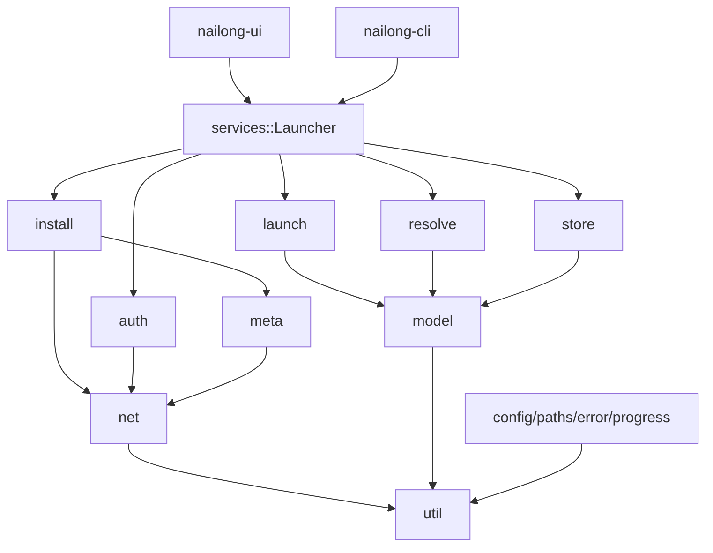
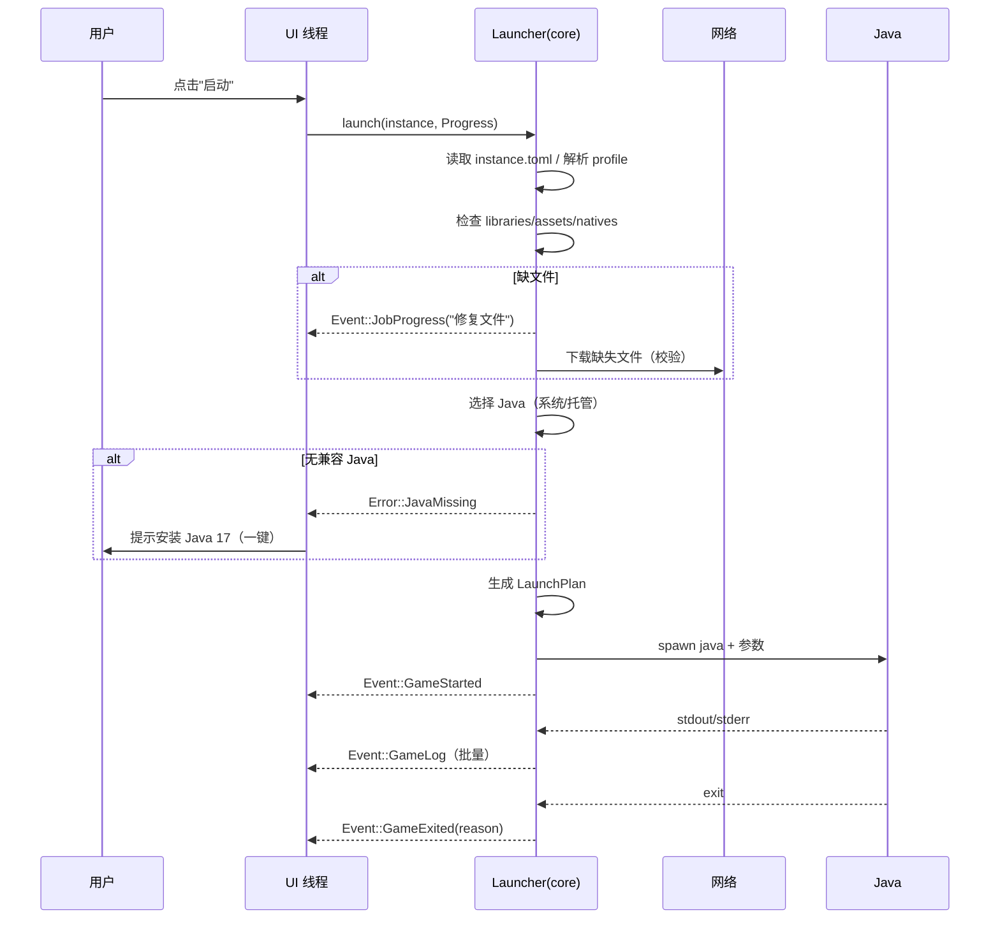

# 03 · 总体架构

> 本文定义代码如何组织、运行时如何协作、错误如何表达。数据模型见 [04](04-version-model.md)，启动细节见 [05](05-launch-pipeline.md)。

## 1. 设计目标

1. **核心可无头运行**：`nailong-core` 不依赖 GUI，CLI 与测试可以直接驱动完整流程。
2. **依赖方向单一**：UI → core；core 内部 `model → resolve → install/launch`；不允许反向依赖。
3. **计划可测试**：启动参数、classpath、下载清单都是纯函数产物，可用快照测试断言。
4. **失败可解释**：每个错误有稳定错误码；UI 只做"错误码 → 文案"映射。
5. **并发不泄漏**：所有长任务接受 `CancellationToken`；所有子进程、临时文件、部分下载都有清理路径。

## 2. Workspace 与依赖方向

### 2.1 目录

```text
nailong/
├─ Cargo.toml                 # workspace
├─ rust-toolchain.toml
├─ crates/
│  ├─ nailong-core/           # 领域内核 + 服务门面
│  │  ├─ src/
│  │  │  ├─ lib.rs
│  │  │  ├─ services.rs       # Launcher 门面（唯一对外入口）
│  │  │  ├─ error.rs
│  │  │  ├─ progress.rs
│  │  │  ├─ paths.rs          # Root/Layout，纯路径计算
│  │  │  ├─ config.rs         # 全局配置 + 迁移
│  │  │  ├─ model/            # 纯数据：version/library/rule/instance/account
│  │  │  ├─ resolve/          # 继承合并、规则、classpath、参数（纯函数）
│  │  │  ├─ net/              # HTTP、候选 URL、下载器、缓存、镜像规则
│  │  │  ├─ meta/             # Mojang/Fabric/Quilt/Forge/NeoForge 元数据
│  │  │  ├─ install/          # 原版、加载器、Java、整合包、校验
│  │  │  ├─ launch/           # Java 探测/选择、计划、进程、日志、崩溃
│  │  │  ├─ auth/             # MSA/Xbox/离线/authlib-injector/凭据存储
│  │  │  └─ store/            # 实例仓库、账户仓库、设置
│  │  └─ tests/
│  ├─ nailong-ui/             # eframe 应用（只依赖 core）
│  └─ nailong-cli/            # clap CLI（只依赖 core）
├─ assets/                    # 字体、图标、log4j 模板（编译期嵌入）
├─ docs/
└─ xtask/                     # 打包、图标生成（可选）
```

### 2.2 为什么先做一个 core crate

- 小团队 + 单人开发时，多 crate 会带来大量 `pub use`、版本同步与编译噪音；Rust 的模块系统足以表达边界。
- 模块边界用**约定 + CI 检查**保证：`model`/`resolve` 不出现 `reqwest`/`tokio::process`；`core` 不出现 `egui`。
- 当 `nailong-core` 超过约 2 万行或编译时间超过 60 s 时，按现有模块边界拆为 `nl-model` / `nl-net` / `nl-install` / `nl-launch` / `nl-auth`，不改变 API。

### 2.3 模块依赖图



依赖规则（CI 用 `cargo-modules` 或简单 grep 检查）：

| 模块 | 允许依赖 | 禁止 |
|---|---|---|
| `model` | `serde`, `util` | `net`, `tokio::process`, `reqwest` |
| `resolve` | `model`, `util` | `net`, `install`, `launch` |
| `net` | `util`, `config` | `model` 的业务类型（只传 URL/路径） |
| `meta` | `net`, `model` | `install`, `launch` |
| `install` | `net`, `meta`, `model`, `resolve`, `launch::java` | `launch::exec` |
| `launch` | `model`, `resolve`, `util` | `install`（避免启动时隐式安装） |
| `auth` | `net`, `model`, `store` | `install` |
| `services` | 全部 | — |

> 启动时发现缺文件怎么办？`launch` 返回 `Error::MissingFiles { plan }`，由 `services` 决定是否先调用 `install::repair`。这样 `launch` 保持纯净，也不隐藏网络行为。

## 3. 运行时模型

### 3.1 线程与任务

```text
┌──────────────────────────────┐
│ 主线程：eframe / winit 事件循环 │  ← 只做 UI、永不阻塞
└──────────────┬───────────────┘
               │ 调用 async API（Handle::spawn）
┌──────────────▼───────────────┐
│ tokio Runtime（2–4 worker）   │
│  ├─ 元数据/下载任务            │
│  ├─ 安装编排                  │
│  ├─ 启动准备 + 进程监控        │
│  └─ 认证轮询/刷新             │
└──────────────┬───────────────┘
               │ mpsc::Sender<UiEvent>
┌──────────────▼───────────────┐
│ UI 事件队列（有界，合并进度）   │
└──────────────────────────────┘
```

规则：

- **UI 线程不做文件 IO、不做网络、不 `block_on`**。所有操作返回 `TaskId`，结果通过事件回来。
- tokio worker 数 = `min(4, available_parallelism)`；下载并发由 `Semaphore` 控制，不靠线程数。
- CPU 密集操作（zip 解压、哈希校验、图片解码）走 `spawn_blocking`，避免阻塞异步 worker。
- 不在持有 `std::sync::Mutex` 时 `.await`；跨任务共享状态用 `Arc<RwLock<...>>` 且只在短临界区使用。
- 子进程统一由 `launch::exec` 管理；取消时先 `kill` 再 `wait`，避免僵尸进程。
- **单实例**：通过 `interprocess` 绑定本地 socket；第二个实例把 CLI 参数（如 `.mrpack` 路径）发给主实例后退出，主实例聚焦窗口并处理导入。避免两个进程同时写 libraries/assets。
- **深链**（v1.1）：注册 `nailong://`，用于网页"一键导入整合包"；解析时必须再次校验来源与路径，不直接执行远程内容。

### 3.2 门面 API

`nailong-core` 只暴露一个门面与少量视图类型：

```rust
pub struct Launcher { ctx: Arc<Context> }

impl Launcher {
    pub async fn open(root: Root, cfg: Config) -> Result<Self>;

    // 只读查询
    pub async fn instances(&self) -> Result<Vec<InstanceView>>;
    pub async fn instance(&self, id: &InstanceId) -> Result<InstanceView>;
    pub async fn accounts(&self) -> Result<Vec<AccountView>>;
    pub async fn remote_versions(&self, refresh: bool) -> Result<VersionList>;

    // 变更
    pub async fn create_instance(&self, req: CreateInstance) -> Result<InstanceId>;
    pub async fn update_instance(&self, id: &InstanceId, patch: InstancePatch) -> Result<()>;
    pub async fn delete_instance(&self, id: &InstanceId, delete_files: bool) -> Result<()>;

    // 长任务
    pub async fn install(&self, req: InstallRequest, p: &Progress) -> Result<InstallReport>;
    pub async fn verify(&self, id: &InstanceId, p: &Progress) -> Result<VerifyReport>;
    pub async fn repair(&self, id: &InstanceId, p: &Progress) -> Result<InstallReport>;
    pub async fn launch(&self, id: &InstanceId, p: &Progress) -> Result<GameHandle>;
    pub async fn import_pack(&self, path: PathBuf, p: &Progress) -> Result<InstanceId>;

    // 认证
    pub async fn login_microsoft(&self, flow: MsaFlow, p: &Progress) -> Result<AccountId>;
    pub async fn login_offline(&self, name: &str) -> Result<AccountId>;
    pub async fn refresh_account(&self, id: &AccountId) -> Result<()>;
    pub async fn logout(&self, id: &AccountId) -> Result<()>;

    // 事件
    pub fn subscribe(&self) -> broadcast::Receiver<Event>;
}
```

设计约束：

- **请求/响应类型都在 core 中定义**，UI 不拼装内部结构。
- `InstanceView` 是只读快照（`Clone`），包含展示所需字段，不暴露路径句柄或锁。
- `GameHandle` 提供 `pid()`、`wait()`、`kill()`、`log_snapshot()`；日志实时流通过 `Event::GameLog` 合并发送（限流）。
- 事件中的 `JobProgress` 可按 `TaskId` 合并；UI 不依赖每个字节都到达。

### 3.3 事件

```rust
#[derive(Debug, Clone, Serialize)]
pub enum Event {
    InstancesChanged,
    InstanceChanged(InstanceId),
    AccountsChanged,
    JobStarted { id: TaskId, title: String, total: Option<u64> },
    JobProgress { id: TaskId, stage: StageId, done: u64, total: Option<u64>, msg: Option<String> },
    JobFinished { id: TaskId, result: JobResult },
    GameStarted { instance: InstanceId, pid: u32 },
    GameExited { instance: InstanceId, code: Option<i32>, reason: ExitReason, crash: Option<PathBuf> },
    GameLog { instance: InstanceId, lines: Vec<LogLine> }, // 100–200 ms 批量
    AccountExpired { account: AccountId },
    Toast { level: ToastLevel, code: &'static str, detail: Option<String> },
}
```

- `broadcast` 容量 1024；慢消费者会收到 `Lagged`，UI 重新拉快照即可。日志不走 broadcast，而走独立的 `mpsc`（有界，丢旧行），防止一条刷屏日志阻塞全局事件。
- 事件是 **UI 的唯一输入**；UI 不直接读 core 内部状态。

## 4. 任务、进度与取消

### 4.1 不做通用 DAG 引擎

HMCL 的 `Task` 是强大的双向 DAG，但图在执行期动态生长，难以静态分析与持久化（见 [01](01-prior-art.md#41-关键事实)）。nailong 采用更小的模型：

- **编排 = 普通 async 函数**：`install_vanilla` / `install_forge` 等按阶段 `await`。
- **并发 = `JoinSet` + `Semaphore`**：下载文件、校验文件。
- **进度 = 显式的阶段树 + 字节计数**：`Progress` 句柄自报阶段与权重。
- **取消 = `CancellationToken`**：每个阶段检查；下载/子进程原生支持中断。

这样没有"任务框架"，只有普通 Rust 代码，调试与测试成本最低。

### 4.2 进度

```rust
pub type TaskId = u64;

#[derive(Clone, Copy, Debug)]
pub struct StageId(&'static str); // e.g. "download.client", "assets", "java", "forge.processors"

pub trait ProgressSink: Send + Sync {
    fn emit(&self, ev: ProgressEvent);
}

pub struct Progress {
    task: TaskId,
    sink: Arc<dyn ProgressSink>,
    cancel: CancellationToken,
}

impl Progress {
    pub fn stage(&self, id: StageId, weight: u32) -> StageGuard;
    pub fn bytes(&self, done: u64, total: Option<u64>);   // 下载/解压
    pub fn items(&self, done: u64, total: u64);          // 文件数
    pub fn message(&self, msg: impl Into<String>);
    pub fn cancelled(&self) -> bool;
    pub fn check(&self) -> Result<()>;                    // 取消则返回 Error::Cancelled
}
```

- 父阶段按**权重**聚合子阶段；同一时刻只展示一个"当前阶段 + 总进度"。
- 下载阶段用**字节**而非文件数（避免"卡在 99%"）；未知总大小时显示不确定进度条。
- 核心层节流：同一 `TaskId` 的进度事件最多 10 Hz；完成/失败事件必发。
- 进度不持久化；安装中断后的恢复依据磁盘状态，而非任务日志。

### 4.3 取消与清理

| 操作 | 取消行为 |
|---|---|
| HTTP 下载 | `select!` 取消；保留 `.part` 与元数据，下次可续传；删除未验证的临时文件 |
| 文件解压 | 在条目边界检查；删除半成品目录 |
| Java 子进程 | `kill()` + `wait()`；Windows 使用 `CREATE_NO_WINDOW`，必要时 Job Object 杀进程树 |
| Forge processors | 终止当前 processor 子进程；清理 `staging` 目录；已完成的 outputs 保留（可重入） |
| 安装提交 | 先写临时目录，`rename` 原子提交；取消发生在提交前则整体丢弃 |

### 4.4 重试策略

- 网络：每个候选 URL 最多 3 次；仅对连接错误、超时、5xx、408/429 重试；退避 0.5 s → 1 s → 2 s + 抖动。
- 校验失败：**不重试同一 URL**，直接换候选；全部失败则报 `VERIFY_CHECKSUM`。
- 认证：401 触发一次刷新；刷新失败要求重新登录，不循环。
- 安装器：processors 非 0 退出不自动重试；保留日志供诊断。

## 5. 错误模型

```rust
#[derive(Debug, thiserror::Error)]
pub enum Error {
    #[error("io error at {path}: {source}")]
    Io { path: PathBuf, #[source] source: std::io::Error },

    #[error("http {status} for {url}")]
    Http { status: u16, url: String },

    #[error("network error for {url}: {source}")]
    Net { url: String, #[source] source: reqwest::Error },

    #[error("checksum mismatch at {path}: expected {expected}, got {actual}")]
    Checksum { path: PathBuf, expected: String, actual: String },

    #[error("no compatible java: required major {required}")]
    JavaMissing { required: u32 },

    #[error("java {found} is not compatible with this version (required {required})")]
    JavaIncompatible { required: u32, found: u32 },

    #[error("version {0} not found")]
    VersionNotFound(String),

    #[error("unsupported loader {loader} for minecraft {game}")]
    LoaderUnsupported { loader: String, game: String },

    #[error("forge processor failed: {name} (exit {code})")]
    ProcessorFailed { name: String, code: i32 },

    #[error("authentication failed: {code}")]
    Auth { code: &'static str, detail: String },

    #[error("archive entry is unsafe: {path}")]
    UnsafeArchiveEntry { path: String },

    #[error("cancelled")]
    Cancelled,
}

impl Error {
    /// 稳定错误码，用于 i18n 与日志检索；不要随文案变化。
    pub fn code(&self) -> &'static str { /* NET_HTTP, FS_IO, ... */ }
    pub fn is_retryable(&self) -> bool { /* ... */ }
}
```

- core 内**不使用 `anyhow`**；`anyhow` 只允许出现在 `nailong-ui` / `nailong-cli` 的顶层。
- 错误码表与 UI 文案解耦：新增错误只改 `code()` 与翻译文件。
- 所有错误附加上下文（URL、路径、阶段），但**不得**包含 access token / refresh token。
- 日志记录 `error.code` + `tracing` span；UI 显示"用户可读原因 + 可操作建议 + 打开日志"。

## 6. 持久化与文件安全

### 6.1 原子写

```rust
pub fn write_atomic(path: &Path, bytes: &[u8]) -> Result<()> {
    let tmp = path.with_extension(format!("tmp-{}-{}", std::process::id(), rand::random::<u32>()));
    let mut f = File::create(&tmp)?;
    f.write_all(bytes)?;
    f.sync_all()?;
    replace_file(&tmp, path)?; // Unix: rename; Windows: ReplaceFileW / remove+rename
    Ok(())
}
```

- 所有配置、实例元数据、profile JSON 使用原子写。
- 大文件先写 `<target>.part`，校验通过后原子替换。
- Windows 上目标存在时的替换使用 `ReplaceFileW`（保留 ACL），失败再降级 remove+rename。
- 目录只在必要时 `sync_all`（性能考虑）；提交标记文件最后写。

### 6.2 锁

| 锁 | 粒度 | 目的 |
|---|---|---|
| `shared/.install.lock` | 全局安装/修复 | 防止两个进程同时写 libraries/assets |
| `instances/<id>/.lock` | 实例启动/修改 | 防止同一实例并发启动/改配置 |
| `cache/.lock` | 缓存清理 | 防止清理时正在写 |

- 使用 `fs4` 的 advisory lock；获取失败时等待最多 2 s，然后提示"另一个 nailong 正在操作"。
- 读操作不加锁；原子写保证读者不会看到半个文件。

### 6.3 路径安全

- 所有来自 JSON/压缩包的路径必须**相对**、无 `..`、无盘符、无 NUL；规范化后必须位于预期根目录内。
- 符号链接：解压时默认拒绝；版本 JSON 不解析符号链接。
- 临时文件统一放在目标同分区，保证 `rename` 原子性。

## 7. 并发参数

| 场景 | 默认值 | 依据 |
|---|---|---|
| tokio worker | `min(4, cores)` | UI 与网络为主，I/O 密集 |
| 全局下载并发 | `min(4 * cores, 64)` | 与 HMCL 的经验值一致 |
| 单主机并发 | 8 | 避免被 CDN 限流 |
| 大文件（>64 MB）连接数 | 1（v1） | 简化续传；后续可多段 |
| 资源哈希校验 | 4 个 blocking worker | 避免打满 CPU |
| 事件批量 | 100–200 ms | UI 流畅 |

所有数值可在配置中调整；运行时改变并发只影响新任务（`Semaphore` 动态增减实现较复杂，v1 重启生效）。

## 8. 启动时序（UI 视角）



## 9. 测试策略

| 层 | 方法 | 重点 |
|---|---|---|
| 纯函数 | 单元测试 + `insta` 快照 | 版本合并、规则判定、classpath、参数替换 |
| 网络 | `wiremock` 本地 HTTP | 候选切换、重试、ETag、Range、校验失败 |
| 文件 | `tempfile` | 原子写、路径穿越、解压限额、恢复 |
| 启动 | 假 Java（脚本记录 argv） | 参数顺序、natives、cwd、env、取消杀进程 |
| Forge | 微型假 jar + 假 Java | processor 变量、outputs 跳过、哈希校验 |
| 认证 | mock OAuth/Xbox | PKCE、状态校验、刷新、错误码 |
| UI | 快照/手工清单 | 关键页面渲染、i18n 截断、DPI |
| 端到端 | 夜间任务 | 真实下载 1.20.1/26.3 + Fabric/Forge 启动（受网络影响，非阻塞合并） |

假 Java 示例（测试夹具）：

```sh
#!/bin/sh
# 记录收到的参数，模拟退出码
printf '%s\n' "$@" > "$NAILONG_TEST_ARGV"
exit "${NAILONG_TEST_EXIT:-0}"
```

## 10. Cargo 配置草图

```toml
[workspace]
resolver = "3"
members = ["crates/nailong-core", "crates/nailong-ui", "crates/nailong-cli"]

[workspace.package]
edition = "2024"
rust-version = "1.95"
version = "0.1.0"
license = "GPL-3.0-or-later"

[workspace.dependencies]
tokio = { version = "1.54", features = ["rt-multi-thread", "macros", "fs", "process", "io-util", "sync", "time"] }
reqwest = { version = "0.13", default-features = false, features = ["rustls", "json", "stream", "gzip", "brotli", "http2", "system-proxy"] }
serde = { version = "1", features = ["derive"] }
serde_json = "1"
toml = "1"
thiserror = "2"
tracing = "0.1"
tracing-subscriber = { version = "0.3", features = ["env-filter", "fmt"] }
tracing-appender = "0.2"
zip = { version = "9", default-features = false, features = ["deflate"] }
sha1 = "0.11"
sha2 = "0.11"
md-5 = "0.11"
lzma-rs = "0.3"
fs4 = { version = "1", features = ["tokio"] }
directories = "6"
keyring = { version = "4", features = ["apple-native", "windows-native", "sync-secret-service"] }
uuid = { version = "1", features = ["v4", "v5", "serde"] }
url = "2"
rand = "0.10"
base64 = "0.23"
image = { version = "0.25", default-features = false, features = ["png", "jpeg"] }
rfd = "0.17"
open = "5"

# 版本号以 2026-10 的 crates.io 为准；实现时用 cargo add 锁定并与 MSRV 对齐。
```

> 依赖原则：能用标准库就不引 crate；不为一个函数引入一个大依赖；所有新增依赖需说明体积/维护状态；`cargo-deny` 检查许可证与漏洞。

## 11. 二进制与启动优化

| 手段 | 说明 |
|---|---|
| `lto = "thin"` + `codegen-units = 1` | 体积与运行时的平衡；发布前对比 `fat` |
| `strip = "symbols"` | 去除符号；保留独立 debug 产物用于崩溃分析 |
| `opt-level = "s"` | 体积优先；下载/解压热路径可对个别 crate 用 `opt-level = 3` |
| `panic = "abort"` | 减小体积；代价是无法 `catch_unwind`。v1 先保持 `unwind`，测量后再定 |
| 关闭未用 features | `reqwest` 默认 TLS/HTTP2 裁剪；`image` 只开 png/jpeg |
| 嵌入资源压缩 | 字体子集、图标用 PNG/压缩；避免把整套 CJK 字体打进二进制 |
| 延迟初始化 | 启动只读配置与实例列表；版本清单/Java 探测后台进行 |
| Windows GUI 子系统 | `#![windows_subsystem = "windows"]`；`--console` 时 `AttachConsole` |

## 12. 已知取舍

1. **一个 core crate vs 多 crate**：先单 crate，规模上来再拆；边界已按可拆方式设计。
2. **不做通用任务框架**：牺牲"任意任务图"能力，换取可读性与可测试性；当前需求（安装、启动、认证）都是线性阶段。
3. **事件驱动 UI 而非共享状态**：UI 需要维护快照，代码略多，但避免了锁与跨线程借用问题。
4. **不使用数据库**：实例 < 1000 时文件扫描足够快；缓存与索引都是可选优化。若未来模组数量爆炸，再引入 SQLite。
