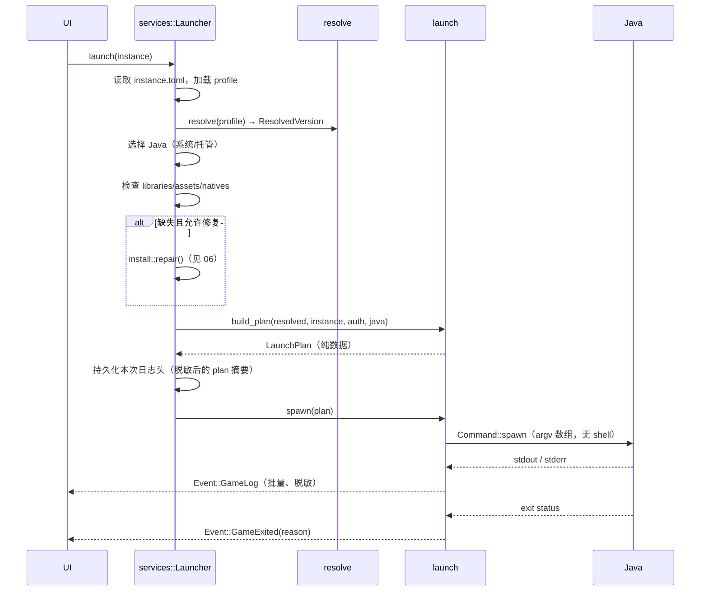

# 05 · 启动流水线

> 从"点击开始"到"Java 进程退出"的完整规格。核心原则：**先算出纯数据的 `LaunchPlan`，再执行**；参数顺序与变量替换必须可快照测试。

## 1. 总览



失败分层：

| 阶段 | 失败示例 | 处理 |
|---|---|---|
| 解析 | profile 缺失/成环 | 报错；可尝试自动安装 |
| 校验 | 缺 client jar / library / asset | 报 `MISSING_FILES`，UI 提供"修复并启动" |
| Java | 无兼容版本 / 路径失效 | 报 `JAVA_*`，UI 提供下载/选择 |
| 参数 | 未知占位符 | 保留原样并警告（不阻断） |
| 进程 | 无法创建进程 / 立即退出 | 收集 stderr，分类退出原因 |

## 2. LaunchPlan

```rust
#[derive(Debug, Clone)]
pub struct LaunchPlan {
    pub java: PathBuf,
    pub jvm_args: Vec<OsString>,
    pub main_class: String,
    pub game_args: Vec<OsString>,
    pub classpath: Vec<PathBuf>,
    pub natives_dir: PathBuf,
    pub run_dir: PathBuf,
    pub client_jar: Option<PathBuf>,
    pub env: BTreeMap<OsString, OsString>,
    pub redactions: Vec<String>,          // 日志脱敏用（access token 等）
    pub log_path: PathBuf,
}

impl LaunchPlan {
    /// 最终 argv：java + jvm_args + [main_class] + game_args
    /// classpath 是否已在 jvm_args 中，由 build 阶段保证（见 §5.1）。
    pub fn argv(&self) -> Vec<OsString> { /* ... */ }
    pub fn describe_redacted(&self) -> String { /* 用于日志与导出脚本 */ }
}
```

- `LaunchPlan` **不包含**任何 `Launcher` 句柄、锁或异步资源；可序列化（调试用）。
- 生成计划是同步纯函数（除 Java 探测结果、认证快照、路径存在性外无 IO）；便于测试。
- 执行阶段只负责：创建目录、解压 natives、启动进程、监控日志。

## 3. 前置检查

按顺序执行，失败即返回可操作的错误：

1. 实例存在、`instance.toml` 可解析、`version.profile` 可加载。
2. `resolve` 成功，`main_class` 非空。
3. `run_dir` 可创建/可写；磁盘剩余空间 ≥ 计划下载量 + 512 MB（可选提示）。
4. `client_jar` 存在（或 `jar` 重定向目标存在）。
5. classpath 中每个文件存在；natives jar 存在。
6. 资源索引存在；`assets/objects` 抽查（不逐個哈希，完整校验由 repair 负责）。
7. Java 可执行文件存在且可运行；版本满足约束。
8. 账户有效（令牌未过期或可刷新）；离线账户直接通过。
9. 路径检查：Windows 长路径、非 ASCII（旧版本警告）。

> 设计取舍：启动前**不**默认做全量哈希校验（数千个资源会拖慢启动）。安装时已校验；启动只检查存在与大小；用户可手动"校验文件"。

## 4. Java 选择

### 4.1 需求推断

优先级：

1. manifest 的 `javaVersion.majorVersion`（1.17+ 均有）。
2. 若无（≤1.16.5），按版本表：
   - `≤1.12.2` → Java 8
   - `1.13–1.16.5` → Java 8（最低）
   - 日期式版本（`26.x`）→ 25（以 manifest 为准；兜底见附录 A）
3. 加载器覆盖：Forge 1.17–1.20.4 建议 17；Forge 1.20.5+ 建议 21；NeoForge 跟随其文档。作为**软约束**提示，不阻止。

### 4.2 兼容规则（硬约束）

| 规则 | 判定 | 违反时 |
|---|---|---|
| 最低版本 | `found >= required` | 排除候选 |
| LaunchWrapper（≤1.12 且 mainClass 为 launchwrapper） | `found <= 8` | 排除（Java 9+ 会崩） |
| Linux x86_64 + MC ≤1.12 | 必须 64 位 Java 8 | 排除 |
| 1.13+ | Java ≥ 8u51 | 排除 |
| 32 位系统 | 仅 Java 8/16/17（按平台） | 提示不支持 |
| Java 25 + 旧 LWJGL | 可能 `MemoryUtil` 问题 | 警告；v2 提供 native patch |

### 4.3 候选来源与排序

1. 托管 JRE（`shared/jre/...`）中 major 完全匹配者。
2. 用户手动添加/自动探测的系统 JDK（`java.mode = auto`）。
3. 若都没有：提示下载对应 Mojang 运行时（`javaVersion.component`）或手动选择。

同 major 多候选时：托管优先 → 版本号更高 → 路径更短（稳定排序）。选择结果写入日志；UI 显示"使用 Java 21.0.7 (Eclipse Adoptium)"。

### 4.4 Java 探测

- 先读 `JAVA_HOME/release`（无需启动进程）：
  ```properties
  JAVA_VERSION="21.0.7"
  OS_ARCH="x86_64"
  IMPLEMENTOR="Eclipse Adoptium"
  ```
- 无 `release` 或需要验证时：运行 `<java> -XshowSettings:properties -version`，解析 stderr 的 `java.version`、`java.home`、`os.arch`、`java.vendor`。
- 超时 5 s；失败标记为不可用（保留在列表中供诊断）。
- 缓存 key = 可执行文件路径 + mtime + size；缓存于 `cache/java.json`。
- 详细扫描路径见 [06 §7.1](06-install-download.md#71-系统-java-探测)。

## 5. Classpath

### 5.1 构造

```text
cp = []
for lib in resolved.libraries (已按子前父后、去重):
    if !rules.allow(lib, os, arch, features): continue
    if is_native(lib): continue
    path = libraries_dir / maven_path(lib)     # 用 downloads.artifact.path 或坐标推导
    if path.exists(): cp.push(path)
    else: missing.push(path)
cp.push(client_jar)                            # 主 jar 永远最后
```

- **存在才加入**：与 HMCL/Prism 一致，允许"缺库也能启动"，错误在游戏侧暴露；同时 `missing` 用于修复提示。
- 主 jar：`manifest.jar` 存在则用其指向的版本目录中的 jar；否则用叶 profile 同名 jar。Forge 的 patched client jar 由 installer 生成并被 profile 引用（`net.minecraftforge:forge:...:client`），作为普通 library 进入 classpath。
- 去重：`LinkedHashSet` 语义，保留首次出现位置。
- 不把 native jar 放进 classpath。

### 5.2 `-cp` 的注入

- 大多数 profile 继承原版，原版 `arguments.jvm` 已包含 `-cp ${classpath}`（1.13+）或启动器需补默认（旧版）。
- 替换后扫描 jvm 参数：若不存在 `-cp` / `-classpath` / `--class-path`，在 mainClass 之前追加 `-cp <cp>`。
- **不要**无条件追加第二个 `-cp`：Forge 1.17+ 依赖原版继承来的 `-cp` 设置 `java.class.path`，BootstrapLauncher 会读取它；重复参数行为依 JVM 实现而异。
- Forge 的 `-p`（module path）与 `${library_directory}` 保留在参数中，不做改写。

### 5.3 手工 classpath 覆盖

高级设置允许用户提供额外的 `-cp` 或 `-javaagent`；顺序为用户参数在默认之后，便于覆盖。

## 6. Natives

### 6.1 判定

```text
native_jars = []
for lib in allowed_libraries:
    if let Some(map) = lib.natives:
        key = map.get(os_name)           # windows / osx / linux
        key = key.replace("${arch}", arch_bits)  # 32 / 64
        artifact = lib.downloads.classifiers[key]
    else if lib.classifier starts_with "natives-":
        artifact = lib.downloads.artifact
    if artifact matches current platform: native_jars.push(artifact)
```

平台匹配：

| OS | 候选 classifier |
|---|---|
| Windows x64 | `natives-windows`, `natives-windows-x86_64`, `natives-windows-amd64` |
| Windows arm64 | `natives-windows-arm64`，回退 `natives-windows`（可能不兼容） |
| Linux x64 | `natives-linux`, `natives-linux-x86_64` |
| Linux arm64 | `natives-linux-arm64`，回退 `natives-linux` |
| macOS x64 | `natives-macos`, `natives-macos-x86_64` |
| macOS arm64 | `natives-macos-arm64` |

只选**一个**最佳匹配；不要同时解压多个架构（会覆盖同名 `.dll`）。

### 6.2 解压目标

2026 年的 26.x 使用：

```text
-Djava.library.path=${natives_directory}/java
-Djna.tmpdir=${natives_directory}/jna
-Dorg.lwjgl.system.SharedLibraryExtractPath=${natives_directory}/lwjgl
-Dio.netty.native.workdir=${natives_directory}/netty
```

因此：

1. 先对 jvm 参数做变量替换前的扫描，找到 `-Djava.library.path=` 的值。
2. 若形如 `${natives_directory}/<sub>`，取 `<sub>`；校验 `<sub>` 不含 `..`、不是绝对路径。
3. 实际解压目录 = `natives_root / <sub>`；否则 = `natives_root`。
4. `${natives_directory}` 本身仍指向 `natives_root`（其他 `-D` 参数依赖它）。

> 该逻辑来自 HMCL 对 26.x 的兼容处理（见 [01](01-prior-art.md#41-关键事实)）。不要简单地把所有 natives 解到根目录，否则 26.x 的 `java.library.path` 找不到库。

### 6.3 解压规则

- 缓存 key：`sha1(profile_id + platform + 每个 native jar 的 sha1)`，目录 `instances/<id>/natives/<key>/`。
- 目录内有 `.complete` 标记（内容为 key + 文件数）；匹配则跳过。
- 解压前清空目标目录（或解压到临时目录再 rename）。
- 过滤：
  - 跳过 `META-INF/`、`*.sha1`、`*.git`、目录项。
  - 应用 `library.extract.exclude` 前缀。
  - 跳过符号链接条目（安全）。
- 保留可执行位：zip 的 Unix mode 有执行位时设置（Linux/macOS 的 `.so`/`.dylib` 不一定需要，但保持一致）。
- 文件名冲突：后解压覆盖先解压（同一架构不同库可能带同名库；按 classpath 顺序，后者覆盖）。记录警告。

### 6.4 非 ASCII 路径规避

旧版 LWJGL（MC <1.19）在 Linux/macOS 上无法加载含非 ASCII 字符路径下的 native 库：

```text
if os in {linux, macos} && !natives_root.is_ascii() && mc_version < 1.19:
    ascii_dir = temp_dir()/nailong-natives-<uuid>
    # 解压到 ascii_dir，并用它替换 ${natives_directory}
```

- 临时目录在游戏退出后删除；启动失败也删除。
- Windows 不启用此规避（路径编码由 JVM 处理），但遇到问题时可在高级设置强制开启。
- 该规避只影响 natives，不影响游戏目录（存档仍可在中文路径下）。
- **Windows argv 编码**：非 Unicode 代码页下，Java 对命令行参数的解码可能出现乱码（JDK-8272352），中文实例名/路径尤其明显。v1 检测系统代码页与路径字符集，给出警告并建议使用 ASCII 路径；v2 评估 JLW/javaagent 或 Java shim。

### 6.5 清理

- 每次启动只保留当前 key 的目录 + 最近 2 个旧 key；其余在空闲时清理。
- "清理缓存"按钮删除所有 `natives/` 与 `cache/`（不影响存档）。
- 切换 Java 架构（x64 ↔ arm64）时 key 变化，自动重新解压。

## 7. 变量表

启动参数中的 `${...}` 按表替换；未知变量**保留原样**并记录警告（某些加载器会自行处理）。

| 变量 | 值 | 备注 |
|---|---|---|
| `${auth_player_name}` | 账户名 | |
| `${auth_uuid}` | UUID（无连字符） | 离线账户按 Java 规则生成 |
| `${auth_access_token}` | 访问令牌 | 日志中脱敏 |
| `${auth_session}` | `token:<access>:<uuid>` | 仅旧版 |
| `${user_type}` | `msa` / `legacy` | 离线账户用 `msa` 以兼容部分服务器 |
| `${user_properties}` | `{}` | 现代客户端不再使用 |
| `${clientid}` | OAuth client id | 可为空字符串 |
| `${auth_xuid}` | Xbox user id | 从 XSTS 声明提取；无则空 |
| `${version_name}` | profile id（叶） | |
| `${version_type}` | `release` / `snapshot` | |
| `${profile_name}` | 实例显示名 | |
| `${game_directory}` | RunDir 绝对路径 | |
| `${assets_root}` | assets 根（或 virtual 目录） | 旧版 `game_assets` 同义 |
| `${game_assets}` | 同上 | 兼容旧参数 |
| `${assets_index_name}` | asset index id | |
| `${natives_directory}` | natives 根 | 可能被替换为 ASCII 临时目录 |
| `${classpath}` | classpath 拼接 | 分隔符由 JVM 决定 |
| `${classpath_separator}` | `;`（Windows）/ `:` | Forge 使用 |
| `${library_directory}` | libraries 根 | Forge 使用 |
| `${launcher_name}` | `nailong` | |
| `${launcher_version}` | 版本号 | |
| `${primary_jar}` / `${primary_jar_name}` | 主 jar 绝对路径 / 文件名 | Forge ignoreList 兼容 |
| `${resolution_width}` / `${resolution_height}` | 窗口尺寸 | 仅当自定义分辨率 |
| `${quickPlayPath}` 等 | Quick Play 参数 | 按需 |
| `${language}` | 系统语言（BCP 47） | 可选 |
| `${game_dir}` 等旧别名 | 同 `game_directory` | 兼容自定义 profile |

实现：

```rust
pub struct VarMap(BTreeMap<String, OsString>);

impl VarMap {
    pub fn expand(&self, s: &str) -> Cow<'_, OsStr> {
        // 用单遍扫描替换 ${key}；未知 key 原样保留
    }
}
```

- 替换只做一次，不递归展开（避免注入）。
- 路径统一用绝对路径；Windows 使用 `\` 或 `/` 均可（Java 接受），保持与系统一致。
- 空值变量替换为空字符串，不删除整个参数（避免 `--xuid` 后参数错位）；必要时由构造逻辑决定是否添加。

## 8. 参数装配顺序

顺序即语义；后出现的同类参数可能覆盖前者。

### 8.1 JVM 参数

```text
1. wrapper（用户配置，tokenize 后原样）
2. java 可执行文件
3. 若 override_jvm_args：用户完整参数；否则：
   3.1 自动默认（add-if-absent）：
       -Xms / -Xmx（用户显式设置优先）
       -Dfile.encoding=UTF-8（及 stdout/stderr 编码）
       -Djava.rmi.server.useCodebaseOnly=true 等 log4j 缓解
       -Dlog4j2.formatMsgNoLookups=true（1.7+）
       -Dminecraft.launcher.brand / version
       -Dminecraft.client.jar=<abs>
       macOS: -Xdock:name / -Xdock:icon
   3.2 manifest 的 arguments.jvm（父在前、子在后，已替换变量）
   3.3 authlib-injector 等账户注入的 JVM 参数
   3.4 用户追加的 jvm_args（add-if-absent 或直接追加）
4. -javaagent（用户/账户）
5. 若参数中无 -cp/-classpath：追加 -cp <classpath>
6. mainClass
7. 游戏参数（见 8.2）
```

### 8.2 游戏参数

```text
1. manifest.minecraftArguments（旧版整串，按空格切分）→ 替换变量
2. manifest.arguments.game（按 rules + features 过滤）→ 替换变量
3. 账户注入的游戏参数（authlib 一般不用）
4. Quick Play / --server / --port（按版本能力降级）
5. --fullscreen（若设置且未出现）
6. 用户追加的 game_args
```

### 8.3 "默认参数"的注入语义

```rust
struct ArgList(Vec<OsString>);

impl ArgList {
    /// 如果已有同前缀参数（如 -Xmx、-Dfoo=），则跳过默认值。
    fn push_default(&mut self, prefix: &str, value: impl Into<OsString>) { /* ... */ }
    fn push(&mut self, value: impl Into<OsString>) { /* ... */ }
}
```

- 自动内存、编码、log4j、launcher brand 全部走 `push_default`，用户可用同前缀参数覆盖。
- `-Xms`/`-Xmx` 的前缀匹配要处理 `-Xmx4G`、`-Xmx=4G`、`-XX:MaxHeapSize=` 三种写法（至少前两种）。
- 用户参数中的 `@argfile`：v1 不展开；视为不透明参数，记录警告（可能与默认值冲突）。
- 不做"先加后删"：所有自动参数都可被抑制，逻辑简单且可预测。

### 8.4 26.x 的 `default-user-jvm`

26.3 的 manifest 新增：

```json
"arguments": {
  "default-user-jvm": [
    { "value": ["-Xms2G", "-Xmx4G", "-XX:+UseCompactObjectHeaders", "-XX:+AlwaysPreTouch", "-XX:+UseStringDeduplication"] },
    { "rules": [{ "action": "allow", "os": { "name": "osx" } }, ..., { "action": "allow", "os": { "name": "windows", "versionRange": { "min": "10.0.17134" } } }], "value": ["-XX:+UseZGC"] },
    { "rules": [{ "action": "allow", "os": { "name": "windows", "versionRange": { "max": "10.0.17134" } } }], "value": ["-XX:+UnlockExperimentalVMOptions", "-XX:+UseG1GC", ...] }
  ]
}
```

处理策略（按参数逐项 `add-if-absent`，而不是整组丢弃）：

1. 规则按 OS/版本过滤（尤其 Windows `versionRange`）；未知系统版本保守跳过。
2. 内存：
   - 用户显式给了 `-Xms`/`-Xmx` → 保留用户值，跳过默认内存。
   - 否则采用 `default-user-jvm`，并做**安全钳制**：`-Xmx ≤ min(系统内存 * 0.5, 8192 MB)` 且 `≥ 2048 MB`；`-Xms ≤ -Xmx`；≤4 GB 内存的机器默认降到 2048 MB。
3. GC/性能标志：
   - 用户已提供任意 `-XX:+Use*GC` 或 `-XX:+UnlockExperimentalVMOptions` → 跳过默认 GC 组，避免冲突。
   - 否则逐项加入（仍走 `add-if-absent`）。
4. Java 兼容：`-XX:+UseCompactObjectHeaders` 仅 Java 25+；用户选 Java 21 时必须移除。维护一张"标志 → 最低 Java major"表；未知标志保留（由 JVM 决定）。
5. 该字段不参与版本继承拼接：子 profile 有则用子，否则用父。

### 8.5 参数去重与冲突

- `--width/--height`：若 manifest 已按 `has_custom_resolution` 添加，用户再设置尺寸时**不再追加**；通过 feature 控制。
- `--fullscreen`：检查是否已存在。
- `--demo`：检查是否已存在。
- `--server/--port` 与 `--quickPlayMultiplayer`：按版本能力二选一（有 quick play 支持则用 quick play）。
- `-Xincgc`：Java 9+ 不支持；启动前过滤（仅旧版 manifest 会出现）。
- `-XX:PermSize`：Java 8+ 忽略/报错？仅 Java 7 及以下添加。

### 8.6 认证注入

```text
--username <name>
--uuid <uuid-no-dashes>
--accessToken <token>
--clientId <client_id>        # 现代版本；无则传空
--xuid <xuid>                 # 现代版本；无则空
--userType msa|legacy
--userProperties {}
```

- 这些通常已由 manifest 的 game args 声明，通过变量替换填入；**不要重复追加**。
- 旧版 `--session` 使用 `token:<access>:<uuid>`。
- authlib-injector 通过 `-javaagent:<jar>=<server>` 注入，不改变游戏参数。

## 9. 进程启动

```rust
let mut cmd = Command::new(&plan.java);
cmd.args(&plan.jvm_args)
   .arg(&plan.main_class)
   .args(&plan.game_args)
   .current_dir(&plan.run_dir)
   .stdin(Stdio::null())
   .stdout(Stdio::piped())
   .stderr(Stdio::piped());
#[cfg(windows)]
cmd.creation_flags(CREATE_NO_WINDOW);
let child = cmd.spawn()?;
```

要点：

- **绝不经过 shell**：避免引号/空格/中文路径问题，也避免注入。
- 环境变量：
  - 继承系统环境。
  - 默认移除 `_JAVA_OPTIONS`、`JAVA_TOOL_OPTIONS`、`JDK_JAVA_OPTIONS`（它们会注入不可控参数导致难排查）；高级设置可保留。
  - 注入 `INST_NAME` / `INST_ID` / `INST_DIR` / `INST_MC_DIR` / `INST_JAVA`（包装脚本/Mod 可用）。
  - 用户自定义 env（实例级）覆盖。
- 工作目录不存在则创建；失败报 `FS_IO`。
- 进程优先级（可选）：Linux/macOS 用 `nice`；Windows 用 `SetPriorityClass`（不通过 `cmd start`）。
- 取消：`kill()` 后 `wait()`；Windows 使用 Job Object 确保子进程树退出（v1 可先只杀直接子进程）。
- 启动后立即记录 PID、命令行摘要（脱敏）、Java 版本、计划文件路径。
- **令牌可见性（v1 的已知取舍）**：Minecraft 仍要求通过 `--accessToken` 传令牌，同机其他用户可能从进程列表看到。v1 接受该风险，并保证日志/事件/导出脚本脱敏；v2 可评估 Java shim（Prism 的 `EntryPoint` 通过 stdin 传 launch script）彻底移出 argv，代价是多一个几十 KB 的 jar 与一层启动协议。

## 10. 日志与退出判定

### 10.1 日志管线

```text
stdout/stderr ──► BufReader::lines ──► 解析级别/去 ANSI ──► 脱敏 ──►
   ├─ 写文件 instances/<id>/logs/game-<timestamp>.log（原始但脱敏）
   ├─ 环形缓冲 VecDeque<LogLine>（2000 行）
   └─ 每 150 ms 批量发 Event::GameLog
```

- 编码：优先 UTF-8；非法字节用 `from_utf8_lossy`。
- 脱敏：把 `access_token`、`refresh_token` 的精确字符串替换为 `<redacted>`；同时处理 `--accessToken <token>` 形式。
- ANSI 转义：发送给 UI 前去除；文件可保留（可选）。
- 级别推断：stderr → ERROR（`[authlib-injector]` 除外）；stdout 按 `[HH:mm:ss] [Thread/LEVEL]` 解析，未知为 INFO。
- 环形缓冲用于崩溃时展示最后 200 行；不无限增长。

### 10.2 退出原因

```rust
pub enum ExitReason {
    Normal,
    JvmError,             // JVM 初始化失败
    ApplicationError,     // 游戏崩溃/异常
    Killed,               // 信号/任务管理器
    Cancelled,            // 用户取消
    LauncherError(String),
}
```

判定规则（按优先级）：

| 条件 | 原因 |
|---|---|
| 用户取消 | `Cancelled` |
| 退出码 0 且无崩溃日志 | `Normal` |
| 日志含 `Could not create the Java Virtual Machine` / `Error occurred during initialization of VM` / `A fatal exception has occurred` | `JvmError` |
| 退出码非 0，或日志含 `Crash report saved to` / `Unable to launch` / `A fatal error has been detected by the Java Runtime Environment` | `ApplicationError` |
| Unix 下被信号杀死（`status.code() == None`） | `Killed` |

- 崩溃报告：扫描 `run_dir/crash-reports/*.txt`，取启动时间之后的最新文件；展示前 20 行与"打开文件"。
- 退出码 0 但日志有 `Exception` 不一定是崩溃（模组常打印异常）；只在出现 `Crash report` 或非 0 时判定。
- 启动成功判定（用于"隐藏启动器"）：日志出现 `LWJGL Version` / `Setting user` / `Created:` 任一，或进程存活 8 s。

### 10.3 日志文件与轮转

```text
instances/<slug>/logs/
  latest.log                 # 本次（符号链接或复制）
  game-2026-10-20T12-30-00.log
  launcher-2026-10-20.log    # 启动器侧该实例相关日志
```

- 保留最近 10 次游戏日志；超出按时间删除。
- 全局启动器日志 `logs/nailong.log` 按大小轮转（10 MB × 5）。

## 11. 启动计划导出（调试）

```bash
nailong launch <instance> --print-plan
nailong launch <instance> --dry-run --export-script ./launch.sh
```

- `--print-plan`：输出 Java 路径、JVM/游戏参数、classpath、natives、工作目录（令牌脱敏）。
- 导出脚本：正确引用参数（Windows `"` 转义、Unix 单引号），并提示脚本含访问令牌、权限 0600。
- 用途：用户反馈问题时可比对 HMCL/Prism 的启动命令，快速定位差异。

## 12. 两个完整示例

### 12.1 Fabric 1.21.11（Java 21）

```text
java
  -Xms1024m -Xmx4096m
  -Dfile.encoding=UTF-8
  -Dlog4j2.formatMsgNoLookups=true
  -Dminecraft.launcher.brand=nailong
  -Dminecraft.launcher.version=0.1.0
  -Djava.library.path=/.../natives/abc
  -Djna.tmpdir=/.../natives/abc
  -Dorg.lwjgl.system.SharedLibraryExtractPath=/.../natives/abc
  -Dio.netty.native.workdir=/.../natives/abc
  -cp <libraries...>:<client.jar>
  -DFabricMcEmu= net.minecraft.client.main.Main
  net.fabricmc.loader.impl.launch.knot.KnotClient
  --username Steve --version fabric-loader-0.18.1-1.21.11
  --gameDir /.../instances/fabric/minecraft --assetsDir /.../assets
  --assetIndex 29 --uuid ... --accessToken ... --clientId ... --xuid ...
  --userType msa --versionType release
```

注意：`-DFabricMcEmu= net.minecraft.client.main.Main ` 是**一个参数**，包含前导空格与尾随空格；不要 trim、不要 split。

### 12.2 Vanilla 26.3（Java 25）

```text
java
  # 来自 default-user-jvm（未自定义内存时，按系统内存钳制）
  -Xms2048m -Xmx4096m -XX:+UseCompactObjectHeaders -XX:+AlwaysPreTouch -XX:+UseStringDeduplication
  -XX:+UseZGC                       # Windows >= 10.0.17134 / Linux / macOS
  --enable-native-access=ALL-UNNAMED
  --add-exports java.base/jdk.internal.misc=ALL-UNNAMED
  -Djava.library.path=/.../natives/<key>/java
  -Djna.tmpdir=/.../natives/<key>/jna
  -Dorg.lwjgl.system.SharedLibraryExtractPath=/.../natives/<key>/lwjgl
  -Dio.netty.native.workdir=/.../natives/<key>/netty
  -cp <classpath>
  net.minecraft.client.main.Main
  --username ... --version 26.3 --gameDir ... --assetsDir ...
  --assetIndex 34 --uuid ... --accessToken ... --clientId ... --xuid ...
  --versionType release
```

关键差异：natives 解压到 `natives/<key>/java`；Java 25 的 `--enable-native-access` 必须保留；`UseCompactObjectHeaders` 不能给 Java 21。

## 13. 测试清单

| 测试 | 断言 |
|---|---|
| 1.7.10 参数 | `minecraftArguments` 正确分词；`--session` 格式；无 `arguments` 不崩溃 |
| 1.20.1 参数 | `-cp` 只出现一次；natives 变量正确；logging 参数 |
| 26.3 参数 | `default-user-jvm` 钳制；natives 子目录；Java 25 参数 |
| Fabric | `-DFabricMcEmu` 保持单参数与空格 |
| Forge 1.20.1 | 继承的原版 `-cp` 保留；`-p` 模块路径；`library_directory` 替换 |
| 用户覆盖 | `-Xmx` 不重复；`override_jvm_args` 跳过自动内存 |
| 中文路径 | argv 原样；旧版走 ASCII natives |
| 取消 | 进程被杀、日志标记 Cancelled、无残留子进程 |
| 日志脱敏 | access token 不出现在文件/事件/崩溃摘要 |
| 崩溃判定 | 构造关键字日志，分类正确 |
