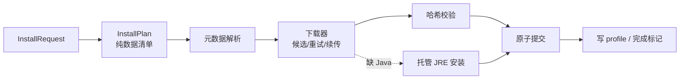

# 06 · 安装与下载

> 本文覆盖：元数据源、镜像、下载器、完整性校验、原版安装、资源与 Java 运行时、加载器安装、整合包导入。
> 目标：**断点可续、失败可解释、镜像可切换、并发不卡 UI**。

## 1. 总览



三个阶段：

1. **计划**：根据目标版本/加载器，解析出所有需要的文件（URL、目标路径、哈希、大小）与要执行的步骤（processors）。
2. **下载**：并发获取，校验，失败换源；可取消、可续传。
3. **提交**：所有文件就位后，原子写入 profile JSON 与完成标记；中途失败不产生"看似安装完成"的版本。

## 2. 元数据源

### 2.1 官方与加载器

| 用途 | URL（2026-10 实测可用） |
|---|---|
| 版本清单 | `https://piston-meta.mojang.com/mc/game/version_manifest_v2.json` |
| 版本 JSON | 清单中每个版本的 `url`（`piston-meta.mojang.com/v1/packages/<sha1>/<id>.json`） |
| Client jar | `https://piston-data.mojang.com/v1/objects/<sha1>/client.jar`（以 JSON 的 `downloads.client.url` 为准） |
| 库 | `https://libraries.minecraft.net/<maven path>`（以 JSON 的 `url` 为准） |
| 资源 | `https://resources.download.minecraft.net/<hash[0..2]>/<hash>` |
| Mojang JRE 清单 | `https://piston-meta.mojang.com/v1/products/java-runtime/2ec0cc96c44e5a76b9c8b7c39df7210883d12871/all.json` |
| Fabric 加载器列表 | `https://meta.fabricmc.net/v2/versions/loader/<mc>` |
| Fabric profile | `https://meta.fabricmc.net/v2/versions/loader/<mc>/<loader>/profile/json` |
| Quilt 加载器列表 | `https://meta.quiltmc.org/v3/versions/loader/<mc>` |
| Quilt profile | `https://meta.quiltmc.org/v3/versions/loader/<mc>/<loader>/profile/json` |
| Forge promotions | `https://files.minecraftforge.net/net/minecraftforge/forge/promotions_slim.json` |
| Forge maven | `https://maven.minecraftforge.net/` |
| Forge installer | `https://maven.minecraftforge.net/net/minecraftforge/forge/<mc>-<forge>/forge-<mc>-<forge>-installer.jar` |
| NeoForge maven | `https://maven.neoforged.net/releases/` |
| NeoForge installer | `https://maven.neoforged.net/releases/net/neoforged/neoforge/<v>/neoforge-<v>-installer.jar` |
| Modrinth API | `https://api.modrinth.com/v2/` |
| CurseForge API | `api.curseforge.com`（需要 key） / `www.curseforge.com/api/v1` / cfwidget |
| authlib-injector（v1.1） | `https://authlib-injector.yushi.moe/artifact/latest.json`（或 BMCLAPI 镜像） |

> 版本清单与 JRE 清单都是**可能变化**的端点；JRE 清单的哈希段是 Mojang 启动器的固定引用，HMCL 也使用同一 URL。设计上把它作为**可配置常量**，镜像可覆盖。

### 2.2 版本清单结构

```json
{
  "latest": { "release": "26.3", "snapshot": "26.4-snapshot-4" },
  "versions": [
    { "id": "26.3", "type": "release", "url": "https://.../26.3.json", "time": "...", "releaseTime": "...", "sha1": "...", "complianceLevel": 1 }
  ]
}
```

- 缓存 15 分钟；带 ETag/Last-Modified 条件请求。
- 版本 id **不假设格式**；排序用 `releaseTime`（ISO 8601），同日用 id 字典序。
- 版本 JSON 下载后校验清单中的 `sha1`。

### 2.3 加载器列表

- Fabric/Quilt：返回 loader 版本数组，含 `stable` 标记；默认选最新 stable，UI 可展开。
- Forge：`promotions_slim.json` 提供每 MC 版本的 `-latest` / `-recommended`；完整列表可解析 maven metadata 或 `files.minecraftforge.net` 页面（脆弱）。v1 提供 recommended/latest + 手动输入版本；完整列表 v1.1。
- NeoForge：maven metadata XML（`net/neoforged/neoforge/maven-metadata.xml`），按 MC 版本过滤；1.20.1 走 `net/neoforged/forge`。
- 所有列表缓存 1 小时；失败时用缓存并提示"可能不是最新"。

## 3. 镜像

### 3.1 设计：数据驱动的 URL 重写

**不为每个镜像写 trait/子类**。一个 `MirrorRule` 表即可：

```rust
pub struct MirrorRule {
    pub from: &'static str,          // 官方前缀
    pub to: &'static str,            // 镜像前缀
    pub fallback_only: bool,         // 只能作为兜底（如内容可能缺失的镜像）
}

pub struct MirrorSet {
    pub name: &'static str,
    pub rules: &'static [MirrorRule],
}
```

内置 BMCLAPI 规则（示例）：

| 官方前缀 | 镜像前缀 |
|---|---|
| `https://piston-meta.mojang.com` | `https://bmclapi2.bangbang93.com` |
| `https://launchermeta.mojang.com` | `https://bmclapi2.bangbang93.com` |
| `https://launcher.mojang.com` | `https://bmclapi2.bangbang93.com` |
| `https://piston-data.mojang.com` | `https://bmclapi2.bangbang93.com` |
| `https://libraries.minecraft.net` | `https://bmclapi2.bangbang93.com/maven` |
| `https://resources.download.minecraft.net` | `https://bmclapi2.bangbang93.com/assets` |
| `https://maven.fabricmc.net` | `https://bmclapi2.bangbang93.com/maven` |
| `https://meta.fabricmc.net` | `https://bmclapi2.bangbang93.com/fabric-meta` |
| `https://meta.quiltmc.org` | `https://bmclapi2.bangbang93.com/quilt-meta` |
| `https://maven.minecraftforge.net` | `https://bmclapi2.bangbang93.com/maven` |
| `https://maven.neoforged.net/releases` | `https://bmclapi2.bangbang93.com/maven` |
| `https://api.modrinth.com` | `https://mod.mcimirror.top/modrinth`（fallback） |

> 实测（2026-10）：BMCLAPI 的版本清单/Forge maven 会 302 到对象存储或 USTC 镜像，需允许重定向；Fabric meta 直接 200。规则必须跟随重定向，不能假设最终域名。

### 3.2 候选顺序

输入：用户设置 `auto | official | mirror | custom` + 地区启发式。

| 设置 | 中国大陆 | 其他地区 |
|---|---|---|
| `auto` | `[mirror, official]` | `[official]` |
| `official` | `[official, mirror]` | `[official]` |
| `mirror` | `[mirror, official]` | `[mirror, official]` |
| `custom` | `[custom, official]` | `[custom, official]` |

- 地区判断不依赖 IP：`Asia/Shanghai` 时区、`zh-CN` 语言、或用户在首次启动时选择。误判只影响默认顺序，可手动切换。
- `fallback_only` 的候选只在官方失败后使用；反之镜像候选失败自动回退官方。
- 同一逻辑文件可能有多个候选 URL；下载器按顺序尝试，**每个候选独立重试**。

### 3.3 自定义镜像

- 用户可填基地址；我们按相同的路径规则重写（`<base>/mc/game/...` 等）。
- 自定义镜像不保证协议/证书；仍强制 HTTPS（允许 `http://localhost` 仅测试）。
- UI 显示每个源的最近成功率/延迟（本地统计），帮助选择。

### 3.4 镜像不代理的内容

- CurseForge 文件下载（CDN 直连或 API 返回 URL）。
- 第三方认证服务器（authlib-injector）。
- 微软登录（必须官方）。

## 4. 下载器

### 4.1 数据结构

```rust
pub struct Candidate {
    pub url: Url,
    pub retries: u8,          // 默认 3
    pub timeout: Duration,    // 默认 30s（大文件 10min）
    pub fallback_only: bool,
}

pub struct FileSpec {
    pub target: PathBuf,
    pub candidates: Vec<Candidate>,
    pub hash: Option<Hash>,   // Sha1/Sha256/Sha512/Md5
    pub size: Option<u64>,
    pub resumable: bool,      // 大文件
    pub executable: bool,
}

pub struct Hash { pub algo: HashAlgo, pub hex: String }
```

### 4.2 流程

```text
for candidate in candidates:
    for attempt in 0..retries:
        try:
            if resumable && part_exists && meta_matches:
                GET Range: bytes=<len>-  If-Range: <etag|last-modified>
            else:
                GET
            stream to .part，边写边 hash
            verify hash/size
            atomic rename .part -> target
            return Ok
        catch retryable:
            backoff(attempt)
    collect error
return Error::Download { attempts }
```

### 4.3 关键行为

| 行为 | 规则 |
|---|---|
| 重试 | 连接错误、超时、5xx、408、429；429 尊重 `Retry-After` |
| 不重试 | 4xx（除 408/429）、哈希不匹配（换候选） |
| 重定向 | 最多 10 跳；检测循环；跨协议降级拒绝（HTTPS→HTTP 除 localhost） |
| 续传 | 仅 `resumable` 且服务器支持 `Accept-Ranges: bytes` + 强 `ETag`/`Last-Modified`；`Accept-Encoding: identity` |
| 续传校验 | 检查 `Content-Range` 起点/总长；416 则从头开始 |
| 压缩 | JSON/文本启用 gzip/br；二进制禁用（影响 Range 与哈希） |
| 并发 | 全局 `Semaphore`；单主机 `Semaphore`；同一目标路径去重 |
| 进度 | 按字节；速度滑动窗口 3 s；ETA |
| 取消 | `select!` 到取消令牌；保留 `.part` 与元数据；未完成不提交 |
| 磁盘 | 预检查可用空间（至少文件大小 × 1.1）；不足报错 |
| 日志 | 只记录 URL 的 host + path（脱敏 query）；失败记录状态码与重试次数 |

### 4.4 缓存（两级）

```text
cache/
  meta/<sha1(url)>.json        # {url, etag, last_modified, body_path, fetched_at}
  meta/<sha1(url)>.body        # 原始 JSON（不可变）
  downloads/<sha1(url)>/...    # 大文件 .part 与状态
  objects/<algo>/<xx>/<hash>   # 已校验内容的可选缓存
```

- **URL 级**：元数据条件请求；304 直接复用 body。
- **内容级**：按哈希寻址，跨 URL/跨版本复用（例如相同库文件）。命中前必须校验哈希。
- BMCLAPI 响应头 `x-bmclapi-hash` 若为 SHA1 且内容缓存存在，可直接命中，省一次下载（可选优化）。
- 缓存清理：UI 显示占用；"清理缓存"只删 `cache/`，不动 `shared/libraries`、`shared/assets`。

### 4.5 批量下载

```rust
pub async fn download_all(
    files: Vec<FileSpec>,
    progress: &Progress,
    cancel: &CancellationToken,
) -> Result<DownloadReport> { /* JoinSet + Semaphore */ }
```

- 先做存在性预检：目标存在且大小匹配（或哈希匹配）→ 跳过，进度直接计入。
- 哈希校验策略：
  - 安装时：必校验（下载流内计算，无二次读）。
  - 已存在文件：默认只查大小；`verify` 命令做全量哈希。
  - 哈希不匹配：删除并重下（一次），再失败则报错。
- 汇总失败项（路径 + 候选 + 最后错误），UI 可"重试失败项"，不必重装全部。

## 5. 原版安装

### 5.1 计划

```rust
pub struct InstallPlan {
    pub profile_id: String,
    pub stages: Vec<InstallStage>,
    pub total_bytes: u64,
    pub required_java: Option<JavaVersion>,
}

pub enum InstallStage {
    FetchVersionJson,
    ClientJar,
    Libraries(Vec<FileSpec>),
    AssetIndex,
    Assets(Vec<FileSpec>),
    LoggingConfig,
    JavaRuntime(JavaRuntimePlan),
    Loader(LoaderPlan),
    Commit(ProfileCommit),
}
```

### 5.2 步骤

1. **版本 JSON**：从清单取 `url`/`sha1`，下载并校验；写入 `shared/versions/<id>/`（先写临时，最后提交）。
2. **Client jar**：下载到 `cache`，校验 SHA1，复制/硬链接到 `shared/versions/<id>/<id>.jar`。
3. **Libraries**：按规则过滤；每个库解析 `downloads.artifact`（或 maven URL）；native 也下载（启动时解压）。跳过已存在且大小/哈希正确者。
4. **Asset index**：下载 `assetIndex.url`，校验 `sha1`，写入 `assets/indexes/<id>.json`。
5. **Assets**：遍历 `objects`，目标 `assets/objects/<xx>/<hash>`；内容寻址，存在即跳过（可按大小）。总大小可达数百 MB（26.3 约 462 MB）。
6. **Logging config**：下载 `logging.client.file`，写入 `assets/log_configs/<id>`。
7. **Java runtime**（可选/按需）：见 §7。
8. **提交**：
   - 写 `shared/versions/<id>/nailong.profile.json`（来源、组件、安装时间、文件统计）。
   - 最后写 `shared/versions/<id>/<id>.json`（原子写）作为"安装完成"标记。
   - 若中断，缺 profile JSON → 下次视为未完成，重新计划；已下载文件复用。

### 5.3 资源（assets）

- **对象存储**：`objects/<hash[0..2]>/<hash>`；文件名即哈希，天然去重与自校验。
- **虚拟资源（≤1.6）**：根据 index 的 `objects` 与 `virtual` 标志，把对象硬链接/复制为 `assets/virtual/<asset-id>/<path>`；Windows 硬链接失败则复制。
- **`--assetsDir`**：
  - 现代版本：`assets` 根。
  - 旧版（virtual）：`assets/virtual/<id>`（或按 manifest 的 `game_assets` 语义）。
- **校验**：安装时逐个校验 SHA1；`verify` 命令全量；启动前只查存在。
- **并发**：assets 数量大，单主机限制 8，全局 32–64；BMCLAPI 镜像可提高。

### 5.4 资源修复

- `verify`：遍历所有计划文件，校验大小/哈希；输出缺失/损坏列表。
- `repair`：只下载缺失/损坏项；不重写 profile（除非 profile 损坏）。
- 快速修复（启动前）：只检查 client jar、libraries、index、natives；assets 抽查最近使用的 50 个。

## 6. 加载器安装

### 6.1 Fabric / Quilt

```text
1. 选 loader 版本（stable / 用户指定）
2. GET profile JSON
3. 写 shared/versions/<profile-id>/<profile-id>.json
4. 安装 libraries：
   - 有 downloads.artifact：按 path/url/hash
   - 只有 name + url：按 maven 坐标拼 URL，使用 sha1/sha256（若有）
5. 完成标记
```

- Fabric profile 的 `libraries` 通常没有 `downloads`，但有 `url` 与 `sha1/sha256/sha512`；必须支持。
- profile 自带 `id` 与 `inheritsFrom`；直接使用，不重写 id（除非冲突）。
- 不修改原版 jar。
- 更新加载器：安装新 profile；实例 `version.profile` 指向新 id；保留旧 profile 供回滚。

### 6.2 Forge / NeoForge（新格式，1.13+）

这是唯一需要"运行外部 JVM"的安装器。流程：

```text
1. 解析原版 version.json（只依赖这一步的元数据）
2. 并行推进：原版 client/libraries、游戏资源、installer 核心条目（约 3 MB）
3. 读取 install_profile.json + version.json + data/client.*
4. 安装 profile.libraries（Forge 的 universal/shim 从 maven 直接下载）
5. 解析 data 变量表
6. 逐个执行客户端 processors（只等 client/libraries，不等资源下完）
7. 写 version.json 到 shared/versions/<id>/
8. 等游戏资源与 processors 都完成，校验最终 profile 的库齐全
```

#### 本机复用与 CAS（0.5.0）

安装前先只读取 `install_profile.json` / `version.json`（约 130 KB），从 `data.PATCHED` 得到最终 patched client 的相对路径。然后在以下位置找同路径文件：

- 当前数据目录；
- 相邻 `.minecraft`；
- 官方 `.minecraft`；
- PrismLauncher / MultiMC / Modrinth 的实例目录；
- `NAILONG_REUSE_ROOTS` 指定的额外目录。

Forge 用 `data.PATCHED_SHA.client` 严格校验 SHA1；NeoForge 当前上游没有这个字段，退化为“可读 JAR + 包含 `net/minecraft/client/main/Main.class` + 至少 1 MB”的结构校验。找到后：

1. 存入 `cache/nailong/blobs/<sha1>`；
2. 硬链接（失败则复制）到 `libraries/...`；
3. 只写 loader version JSON、下载 launch libraries；
4. 跳过 3 MB 补丁和所有 processor。

这是当前 CAS：patched client 按内容寻址；新下载的 client/libraries 也先进入 `blobs/<sha1>` 再硬链接到目标路径；assets 本身已经按 hash 分目录，天然内容寻址。已有文件仍走轻量的 size 检查，不会为了 CAS 重新哈希整个 libraries。

#### 大文件分段（0.5.1）

`download_with` 的单文件批（client jar 等）在满足以下条件时走 4 段 Range：

- 已知文件大小 ≥ 8 MB；
- 有 SHA1；
- 批内文件数 ≤ 2（避免 16 个文件 × 4 段的连接爆炸）。

段文件使用稳定名字 `<dest>.dlpart-<n>`：中断后下次从已有长度继续，不重新下整段。合并后校验大小与 SHA1，再原子替换目标。服务器不支持 Range 时，探测失败直接回退单连接；单段失败也会回退，不会卡死安装。

源回退：每个文件先走当前镜像；失败后自动尝试官方/镜像的另一侧，再进入下一次重试。

#### 轻量读取（0.4.2）

官方 installer 是 6–9 MB 的 zip，但客户端安装真正需要的只有：

- `install_profile.json`（几十 KB）
- `version.json`（几十 KB）
- `data/client.lzma` / 客户端 binary patch（约 3 MB）

其余是服务端数据、安装器 GUI 类、许可证、内嵌 universal 等。安装器只把这些当容器，不需要完整落盘。

实现（`core::install::slim`）：

1. 先发 `Range: bytes=0-0` 探测服务器是否支持分段读取，并从 `Content-Range` 得到总长度。
2. 读文件尾最多 64 KB，定位 ZIP EOCD，解析中央目录；只取需要的本地条目。
3. 校验每个条目的 CRC32、解压后长度；写入 `cache/nailong/installers/<installer>.slim.zip`。
4. 大于 1 MB 的条目（客户端补丁）再切成 4 段并行读取，最后按顺序拼接并整体校验。
5. 成功后删除完整 installer；以后重装/修复直接复用精简 zip。
6. 把精简 zip 再放到机器级缓存（`cache_dir/nailong/patches`）；同一文件系统优先硬链接，否则复制。第二个数据目录直接复用，不再下载 3 MB。
7. 若目标版本已安装且 `health` 无缺失，`forge`/`neoforge` 直接返回，不再读安装器、不再跑 processor。
5. 不支持 Range 的镜像先尝试官方 Maven 的同一路径；仍失败才回退完整下载。完整下载成功后也会转成精简 zip（保留完整包仅作为最后兜底）。

> 兼容性：若客户端 processor 的参数里出现 `{INSTALLER}`，说明它可能需要安装器内的其他文件，此时不做精简，直接使用完整包。

Forge 的 `universal` / `shim` 虽然也在 installer 内，但 `install_profile.libraries` 已给出官方 Maven URL 和 SHA1，直接按普通库下载即可，避免把 3 MB 的 universal 塞进精简包。

#### 变量解析

| 形式 | 解析 |
|---|---|
| `{KEY}` | 引用 data 表中的另一个 key（递归，检测环） |
| `'literal'` | 去引号的字面量 |
| `[group:artifact:version:classifier]` | 映射到 `libraries/<group path>/<artifact>/<version>/<artifact>-<version>[-classifier].jar` |
| `/data/xxx` | 从 installer jar（或精简缓存）解压到临时目录 |
| `{ "client": ..., "server": ... }` | 按 `SIDE` 取对应值；也可为字面量/URL |
| 其他 | 原样字符串 |

内置变量：

```text
SIDE = client
MINECRAFT_JAR = 临时目录中的 client.jar（必须是副本，见下）
MINECRAFT_VERSION = profile.minecraft
ROOT = shared 根（真实目录）
INSTALLER = 精简缓存 / 完整 installer 的绝对路径
LIBRARY_DIR = shared/libraries
```

> **安全/稳定性细节**：
> 1. 把 client.jar 复制到临时目录再传给 processor，避免 installer 修改/移动共享缓存（HMCL 的做法，值得沿用）。
> 2. `ROOT` / `LIBRARY_DIR` 指向真实共享目录，processor 产物直接落到 maven 路径。这样不需要搬运大量文件，且 Forge 的脚本假设通常成立。
> 3. 产物按 `outputs` 的 SHA1 校验；失败/中断留下的半成品下次会被识别为无效并重算。profile JSON 最后写，作为"安装完成"标记。
> 4. 若希望更强隔离，可提供实验性的 staging 模式；默认不启用（避免路径假设带来的兼容问题）。

#### Processor 执行

```rust
for p in profile.processors where p.sides.contains("client") {
    if outputs_present_and_valid(&p.outputs) { continue; }   // 幂等/增量
    let main = read_main_class(&p.jar)?;                      // META-INF/MANIFEST.MF
    let cp = p.classpath + [p.jar];                           // 去重、存在性检查
    let args = p.args.map(resolve_var);
    run_java(&java, &cp, &main, &args).await?;                // 非 0 退出即失败
    verify_outputs(&p.outputs)?;                              // SHA1
}
```

- `outputs` 的哈希校验失败时：不要静默接受；记录并报错。某些环境（zlib-ng）会导致 jar 字节差异，HMCL 有兼容例外；v1 先严格校验，失败时提示"使用官方安装器兜底"。
- `DOWNLOAD_MOJMAPS` processor 可优化为直接下载 mappings（可选；先按普通 processor 跑，确保正确）。
- 并发：processors **顺序执行**（有依赖）；内部下载可并行。
- 超时：每个 processor 10 分钟；可取消（杀进程）。
- 日志：保存每个 processor 的 stdout/stderr 到 `logs/forge-<id>-<n>.log`。

#### 收尾

- 合并 `version.json` 与 installer 的 `libraries`；确保 `inheritsFrom` 正确。
- 检查 profile 引用的所有库存在（尤其是 processor 产物 `net.minecraftforge:forge:...:client`）。
- 写 `nailong.profile.json`：installer 的 SHA1、Forge 版本、processor 列表、时间。
- 失败回滚：删除本次产生的半成品 outputs 与临时 client.jar；已下载库保留（可复用）。

#### 完整安装包兜底（已实现）

轻量读取不是唯一路径。遇到以下情况时自动回退：

- 镜像和官方 Maven 都不支持 HTTP Range；
- ZIP 结构异常（ZIP64、加密、未知压缩方式、CRC 失败）；
- 客户端 processor 的参数引用 `{INSTALLER}`，可能需要完整包内的其他文件。

回退流程：

```text
1. 正常下载完整 installer 到 cache/nailong/installers/
2. 用同一套 Rust 解析器读取并执行客户端 processors（不运行官方 GUI）
3. 成功后尝试生成 *.slim.zip；能精简就删除完整包，否则保留完整包
```

这条路径的进度、镜像和错误处理仍由启动器控制；代价是首次多下载约 3–6 MB。不会调用 `java -jar installer --installClient`。

### 6.3 Forge（旧格式，≤1.12.2）

- `install_profile.json` 含 `install` + `versionInfo`，无 processors。
- 复制 installer 内的 `forge-...-universal.jar` 到 `libraries/net/minecraftforge/forge/<ver>/`。
- 以 `versionInfo` 为基础写 profile；补 `inheritsFrom` 与库。
- 处理 `--tweakClass`（已在 `minecraftArguments` 中）。
- 注意 Java 8 约束（见 05 §4）。

### 6.4 NeoForge

- 1.20.2+：`net.neoforged:neoforge:<version>`；版本号与 MC 的映射由 maven metadata + 规则推断。
- 1.20.1：`net.neoforged:forge:<47.x>`。
- installer 结构与 Forge 新格式一致；processor 主类/maven 不同。
- 仍需 Java（建议 21；1.20.1 用 17）。

### 6.5 加载器版本兼容性

- Fabric/Quilt：必须与 MC 版本匹配（meta 保证）。
- Forge/NeoForge：installer 的 `minecraft` 字段必须等于实例 base；不匹配直接拒绝。
- 实例已有模组时升级加载器：提示可能不兼容；不阻止。
- 降级：保留旧 profile，切换即可。

## 7. Java 运行时管理

### 7.1 系统 Java 探测

| 平台 | 位置 |
|---|---|
| Windows | 注册表 `HKLM\SOFTWARE\JavaSoft\JDK|JRE`、`HKLM\SOFTWARE\Eclipse Adoptium\JDK`；`%ProgramFiles%\Java`、`%ProgramFiles%\Eclipse Adoptium`、`%LOCALAPPDATA%\Programs`、`%USERPROFILE%\.jdks`、`%APPDATA%\.minecraft\runtime` |
| Linux | `$JAVA_HOME`、`PATH` 中的 `java`、`/usr/lib/jvm/*`、`/usr/java/*`、`~/.jdks/*`、`~/.sdkman/candidates/java/*` |
| macOS | `/usr/libexec/java_home -V`、`/Library/Java/JavaVirtualMachines/*/Contents/Home`、Homebrew 路径 |

- 去重：canonical path + major + vendor。
- 探测结果缓存 24 小时；路径 mtime 变化则失效。
- 优先 64 位；32 位仅在必要时展示。

### 7.2 Mojang 运行时下载

1. 下载 `all.json`（缓存 24 小时）。
2. 平台 key：`windows-x64` / `windows-arm64` / `windows-x86` / `linux` / `linux-i386` / `mac-os` / `mac-os-arm64`。
3. 组件：`javaVersion.component`（如 `java-runtime-epsilon`、`java-runtime-delta`、`jre-legacy`）。
4. 取该组件该平台的 manifest URL，下载 manifest。
5. `files` 中逐项：
   - `type: directory` → 创建目录
   - `type: file` → 优先 `downloads.lzma`（体积小），否则 `raw`；校验 SHA1；写文件；`executable` 则设执行位
   - `type: link` → 创建符号链接（失败则复制目标）
6. 全部写入 **暂存目录** `jre/.staging-<uuid>/`，成功后整体 rename 到 `jre/<component>/<platform>/`。
7. 写 `java.json`：`{major, version, vendor, executable, installed_at}`。

要点：

- 运行时约 100 MB（25.0.1，490+ 文件）；并发 8–16，LZMA 解压走 blocking。
- 校验每个文件 SHA1；失败整体重装（不保留半套）。
- 可执行位：Windows 无关；Linux/macOS 必须。
- macOS 的 `jre.bundle/Contents/Home` 是符号链接/目录结构，按 manifest 处理。
- 版本匹配：`javaVersion.majorVersion` 可能小于组件版本（如 17 vs 21），选择 major 相等或更高的组件；优先完全匹配。

### 7.3 兜底：Adoptium

- Mojang 不提供 Linux arm64（截至 2026-10）；Windows arm64/macOS arm64 有。
- 兜底 API：`https://api.adoptium.net/v3/binary/latest/{major}/ga/{os}/{arch}/jre/hotspot/normal/eclipse`。
- 下载 zip/tar.gz 后解压到 `jre/`；校验 SHA256（API 的 assets 接口）；标记 `vendor=temurin`。
- v1 仅在托管组件缺失时提供"手动选择 Java"；自动 Adoptium 下载可作为 v1.1。

### 7.4 存储与清理

```text
shared/jre/
  java-runtime-delta/windows-x64/...
  jre-legacy/windows-x64/...
  .staging-<uuid>/
```

- `java.json` 记录版本与可执行路径。
- UI 显示占用大小；可删除未使用的运行时（正在被实例引用的不删）。
- 损坏检测：启动失败且 `release`/`java` 缺失 → 提示重装。

## 8. 整合包导入

> 完整安装器见 [06 §9]；这里定义格式、顺序与安全策略。

### 8.1 支持格式（按固定顺序探测）

| 顺序 | 格式 | 识别文件 | 说明 |
|---|---|---|---|
| 1 | Modrinth `.mrpack` | `modrinth.index.json` | 无需 API key；文件直链 + 哈希 |
| 2 | CurseForge zip | `manifest.json` + `manifestType=minecraftModpack` | 用 cfwidget HTML 解析 fileID 文件名，构造 forgecdn 直链；无需 API key |
| 3 | Prism/MultiMC zip | `mmc-pack.json` + `.minecraft/` | 组件映射到 base+loader，解压实例目录 |
| 4 | HMCL | `modpack.json` | 未实现；检测到后明确报错 |
| 5 | 手动整合包 | `minecraft/` 或 `overrides/` | 未识别时明确报错 |

> 顺序必须固定：多种格式都可能含 `manifest.json`，靠 schema 校验互斥。

### 8.2 通用流程

```text
1. 识别格式、解析元数据（MC 版本、加载器、文件列表、overrides）
2. 创建实例（名称/图标）
3. 安装 base + loader
4. 下载模组/资源文件到 run_dir（路径校验 + 哈希校验）
5. 解压 overrides（zip-slip/zip-bomb 防护）
6. 写实例元数据（pack_source/pack_id/pack_version）
7. 提交
```

### 8.3 覆盖策略

- **新导入**：overrides 覆盖空目录，无冲突。
- **更新已有整合包**（v1.1）：三方合并——"用户改过的文件不覆盖，用户删掉的不恢复"（记录安装时的哈希）。
- 可选文件（`env.client = "unsupported"` 或 CurseForge optional）默认跳过，记录排除列表。

### 8.4 CurseForge 细节

- `manifest.json` 的 `files[{projectID, fileID, required}]` 只有 ID，没有文件名/URL。
- 解析文件：优先 `cfwidget.com/{projectID}?version={fileID}` 的 HTML 取出文件名，构造 `mediafilez.forgecdn.net/files/{id/1000}/{id%1000:03}/{name}`；失败再尝试 CurseForge 官方 JSON。
- 需要 API key（用户自备或项目内置受限 key）；API 有速率限制，需缓存与退避。
- 不需要 API Key；拿不到文件名时回退 `<projectID>-<fileID>.jar`，不阻断 overrides 导入。
- 不接受从第三方网页抓取（违反 ToS 且脆弱）。

### 8.5 安全

- 压缩包条目数上限（如 100,000）、单文件解压上限（如 2 GB）、总解压上限（如 20 GB）、压缩比上限（如 200:1）。
- 拒绝绝对路径、`..`、盘符、NUL、符号链接/硬链接条目。
- 解压到临时目录，校验后合并；失败清理。
- 下载 URL 必须是 HTTPS；不跟随到私网地址（SSRF 防护，尤其 CurseForge API 返回的 URL）。

## 9. 失败与恢复

| 场景 | 现象 | 恢复 |
|---|---|---|
| 下载中断 | `.part` 存在 | 下次 Range 续传；哈希校验后提交 |
| 镜像返回 HTML/404 | JSON 解析失败/状态码 | 换下一候选；记录失败源 |
| 哈希不匹配 | 文件损坏/镜像旧 | 删除，换候选；全失败报 `CHECKSUM_MISMATCH` |
| profile 未写完 | 版本列表不显示 | 视为未安装；复用已下载库/资源 |
| Forge processor 失败 | 非 0 退出 | 保留 processor 日志；提示换官方源/外部 installer |
| Java 运行时损坏 | `java` 不存在/无法执行 | 标记损坏；重新下载 |
| 磁盘满 | 写入失败 | 提前检查；失败时清理 `.part` 与临时文件 |
| 权限不足 | 无法写 shared | 提示更换数据目录/以用户目录运行 |
| 并发安装 | 两个进程写同一文件 | 全局安装锁；第二次等待或提示 |

## 10. 性能目标

| 项目 | 目标 |
|---|---|
| 1.20.1 首次安装（100 Mbps） | ≤ 4 min（资源约 300–500 MB，网络瓶颈） |
| 已有库/资源复用 | 二次安装 ≤ 20 s |
| 启动前检查 | ≤ 300 ms（不哈希） |
| 全量校验 | 受磁盘限制；1 TB HDD 约 1–3 min |
| 下载 CPU 占用 | < 5%（哈希流式计算） |
| 失败重试额外流量 | 仅重试失败文件，不整包重下 |

## 11. 测试

| 测试 | 方法 |
|---|---|
| 候选切换 | mock 服务器：第一个 500，第二个 200 |
| 续传 | mock 返回 206 + Content-Range；断言最终哈希 |
| 416 回退 | 服务器拒绝 Range，断言从头下载 |
| ETag | 第二次返回 304，断言不重复下载 |
| 哈希失败 | 返回错误内容，断言换源/报错 |
| 原子提交 | 在 rename 前中断，断言目标不存在 |
| 资源去重 | 两个版本共享 asset，断言只下载一次 |
| Forge processors | 假 installer（两个 processor）+ 假 Java 创建 outputs；断言变量、跳过、失败 |
| 整合包安全 | 构造 `../evil`、zip bomb、symlink 条目，断言拒绝 |
| Java 运行时 | 假 manifest + 小文件，断言 lzma/raw、执行位、链接回退 |

## 12. 端点维护

- 端点常量集中在 `meta/endpoints.rs`，附最后验证日期。
- 夜间 CI 对一个版本做真实解析（不下载大文件），端点失效时报警。
- 镜像规则版本化；用户可覆盖。
- 不在代码中散落 URL 字符串。
