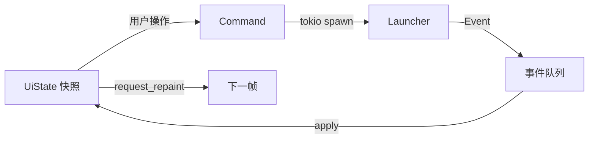

# 08 · 界面与交互

> 技术基础：egui/eframe（见 [02](02-tech-stack.md#2-gui-选型)）。本文定义信息架构、页面、状态流、视觉与 i18n。
> 设计目标：**三步开玩、状态可见、失败可解释、中文优先**。

## 1. 原则

1. **启动是主路径**：打开应用 → 选实例 → 开始；最多三次点击。
2. **不暴露复杂度**：JVM 参数、natives、classpath 默认隐藏；高级设置折叠。
3. **进度永远可见**：下载/安装/启动都有阶段与可取消操作，不出现"假死"。
4. **错误给人话**：错误码 → 中文原因 → 可操作按钮（重试/换源/打开日志）。
5. **视觉克制**：深/浅色两套，暖黄色作为品牌强调；不使用花哨背景干扰阅读。
6. **中文优先**：字体、断行、标点、文案按中文习惯；英文完整翻译。

## 2. 应用结构

```text
main()
 └─ eframe::run_native
     └─ NailongApp (impl eframe::App)
         ├─ Runtime（tokio Handle + 事件接收）
         ├─ UiState（只读快照 + 临时交互状态）
         └─ Pages
             ├─ FirstRun
             ├─ Shell（侧边栏 + 内容区）
             │   ├─ Home（实例网格）
             │   ├─ InstanceDetail
             │   ├─ Downloads
             │   ├─ Settings
             │   └─ About
             └─ Overlays（新建实例向导、账户、确认框、崩溃报告）
```

### 2.1 状态流



- `UiState` 只存**展示所需**数据；业务真相在 core。
- 事件到达时更新状态并 `ctx.request_repaint()`；空闲时不重绘（省电）。
- 长任务在 core 中运行；UI 关闭不影响任务？v1：关闭应用会取消任务（提示确认）；v1.1 支持后台托盘继续下载。

### 2.2 命令

```rust
enum Command {
    RefreshInstances,
    CreateInstance(CreateInstanceDraft),
    Install { instance: Option<InstanceId>, target: InstallTarget },
    Launch(InstanceId),
    Cancel(TaskId),
    Verify(InstanceId),
    DeleteInstance { id: InstanceId, delete_files: bool },
    LoginMicrosoft { flow: MsaFlow },
    AddOffline { name: String },
    ImportPack(PathBuf),
    OpenFolder(PathBuf),
    SaveSettings(SettingsDraft),
    Quit,
}
```

- UI 只构造命令；不直接调用 `std::fs` 或网络。
- 命令结果通过 `Event` 回来；失败弹 toast + 详情。

## 3. 信息架构

```text
┌──────────────────────────────────────────────────────────────┐
│ 侧边栏 72px      │ 主内容区                                  │
│                  │                                            │
│  ● 主页          │  顶部：标题 + 搜索 + 账户胶囊 + 设置         │
│  ● 实例          │                                            │
│  ● 下载          │  内容：实例卡片网格 / 详情 / 表单            │
│  ● 设置          │                                            │
│                  │                                            │
│  账户头像        │  底部：全局任务条（可折叠）                  │
└──────────────────────────────────────────────────────────────┘
```

- 侧边栏固定 72 px（仅图标 + 悬浮 tooltip），主内容最大宽度 1200 px 居中；窗口小则隐藏侧边栏改为顶部标签。
- 账户胶囊：头像 + 名字，点击打开账户弹层。
- 全局任务条：有任务时出现，显示当前阶段 + 总进度 + 取消；点击打开下载中心。

## 4. 页面规格

### 4.1 首次启动

| 步骤 | 内容 | 默认 |
|---|---|---|
| 1 欢迎 | Logo、语言选择（简体中文/English）、"开始" | 跟随系统 |
| 2 数据位置 | 默认 `%APPDATA%/nailong`；可选"便携模式"（exe 同目录 `data/`）；显示磁盘占用 | 默认 |
| 3 下载源 | 自动/官方/镜像；显示说明 | 自动（大陆启发式） |
| 4 账户 | "使用 Microsoft 登录" / "稍后" | 稍后 |
| 5 完成 | 进入主页 | — |

- 不强制登录即可创建/启动离线实例。
- 便携模式通过 exe 旁 `nailong.portable` 标记文件识别；首次选择后写入。

### 4.2 主页 / 实例

- 顶部：`实例` 标题、搜索框（名称/版本）、排序（最近游玩/名称/创建时间）、视图切换（网格/列表）。
- 内容：
  - "新建实例"卡片（虚线边框 + 加号）。
  - 实例卡片：图标 48×48、名称、`1.21.11 · Fabric 0.18.1` 徽标、最近游玩、启动按钮（悬浮时变为"开始"）。
  - 空状态：插画 + "创建你的第一个实例" + 两个按钮（安装新版本 / 导入整合包）。
- 右键菜单：启动、打开文件夹、复制实例、删除、编辑。
- 卡片点击进入详情；启动按钮直接启动（不进入详情）。
- 损坏实例：卡片显示警告徽标，点击给出修复建议。

### 4.3 新建实例向导

```text
步骤 1  选择游戏版本
  [正式版] [快照] [全部]   搜索框
  版本列表（虚拟滚动）：版本号 · 类型 · 发布日期
步骤 2  选择加载器（可选）
  [原版] [Fabric] [Quilt] [Forge] [NeoForge]
  加载器版本下拉（推荐 stable / 最新 / 手动）
  提示：Java 需求、兼容性说明
步骤 3  实例设置
  名称（默认 "1.21.11 Fabric"）
  位置（默认实例目录；显示实际路径）
  内存（默认 4096 MB，滑块 + 输入）
  Java（自动 / 已检测列表 / 下载）
  [创建并安装]
进度页
  阶段列表：解析版本 → 下载库 → 下载资源 → 安装加载器 → 完成
  总进度 + 速度 + 剩余时间 + 取消
  失败：错误卡片 + 重试 / 换源 / 打开日志
```

- 版本列表来自缓存，打开即显示；后台刷新。
- 加载器版本默认 stable；Forge 显示 recommended/latest。
- 安装完成后可直接"启动"或"返回主页"。
- 安装过程中可关闭向导（任务继续在下载中心）；v1 简化：关闭即取消（二次确认）。

### 4.4 实例详情

```text
┌ 图标 名称 [Fabric 0.18.1] [1.21.11]            [开始 ▸] ┐
│ 最近游玩 2 小时前 · 总时长 12h · Java 21.0.7            │
├ 概览 | 模组 | 设置 | 日志 ──────────────────────────────┤
│ 概览：版本信息、加载器、内存、游戏目录、快捷操作          │
│ 模组：mods/ 列表（启用/禁用/删除/打开文件夹）             │
│ 设置：实例级 Java/内存/窗口/参数/隔离/环境变量            │
│ 日志：最近一次启动日志（tail）、崩溃报告入口              │
└────────────────────────────────────────────────────────┘
```

- 启动中：按钮变为"启动中…" + 阶段；可取消；启动后变为"运行中"并可"停止"（二次确认）。
- 快捷操作：打开游戏文件夹、打开日志、复制实例、导出整合包（v1.1）、删除。
- 实例设置保存即时生效（下次启动），不弹"保存"按钮。

### 4.5 设置

| 分组 | 项 |
|---|---|
| 通用 | 语言、主题（跟随系统/浅色/深色）、启动时检查更新、关闭行为 |
| 下载 | 源（自动/官方/镜像/自定义）、并发数、代理、超时、缓存清理 |
| Java | 自动选择、托管运行时列表、手动添加路径、默认内存 |
| 启动 | 全局 JVM 参数、游戏参数、窗口尺寸、全屏、日志级别 |
| 存储 | 数据目录（迁移）、共享资源目录（可指向已有 `.minecraft`）、磁盘占用 |
| 关于 | 版本、许可证、致谢、日志目录、反馈链接 |

- 每项有说明文字（tooltip 或副标题），不要求用户懂 JVM。
- 修改下载源/并发立即生效（新任务）。
- 数据目录迁移：复制 + 校验 + 切换 + 保留旧目录（提示手动删除）。

### 4.6 账户

- 弹层/页面：当前账户、账户列表（头像、名字、类型徽标）、添加按钮。
- 微软登录：
  - 优先打开浏览器；显示"等待浏览器完成登录…" + 取消。
  - 失败/无浏览器：切换设备码，显示 `user_code`（大号等宽）+ 复制 + "打开登录页"。
  - 成功：显示玩家名/头像，回到列表。
- 离线：输入名（实时校验 3–16 字符），提示"仅用于离线/局域网"。
- 外置登录（v1.1）：服务器地址 + 用户名 + 密码；HTTPS 警告。
- 令牌过期：账户行显示"需要重新登录"；启动时阻止并引导。

### 4.7 下载中心

- 当前任务：名称、阶段、进度条、速度、剩余、取消。
- 失败：红色状态 + 错误摘要 + 重试（仅失败文件）。
- 历史：最近 20 条（成功/失败/取消），可清空。
- 空状态："暂无下载任务"。

### 4.8 日志与崩溃

- 日志窗口：等宽字体、自动滚动开关、级别过滤、搜索、复制、打开文件。
- 崩溃：模态卡片显示退出原因、最后 200 行摘要、崩溃报告路径、"打开报告"、"复制诊断信息"。
- 诊断信息包含：版本、加载器、Java、内存、OS、错误码；**不含令牌**。

## 5. 设计系统

### 5.1 颜色

| Token | 深色 | 浅色 | 用途 |
|---|---|---|---|
| `bg` | `#121418` | `#F6F7F9` | 窗口背景 |
| `surface` | `#1A1D23` | `#FFFFFF` | 卡片 |
| `surface_alt` | `#22262E` | `#EEF0F4` | 输入/悬浮 |
| `border` | `#2C313A` | `#DDE1E8` | 分隔线 |
| `text` | `#E8EBF0` | `#1A1D23` | 主文本 |
| `text_muted` | `#9AA3B2` | `#5C6675` | 次要文本 |
| `accent` | `#F2C14E` | `#D99A00` | 品牌/主按钮 |
| `on_accent` | `#1A1A1A` | `#1A1A1A` | 主按钮文字 |
| `success` | `#4CC38A` | `#1F8A5B` | 成功 |
| `warning` | `#E5A54B` | `#B26A00` | 警告 |
| `danger` | `#E5645C` | `#C0392B` | 错误/删除 |

- 主按钮：暖黄底 + 深色字（对比度 > 7:1）；危险操作红色描边，不默认填充。
- 不依赖颜色单独传达状态（配合图标/文字）。

### 5.2 字体与排版

| 用途 | 字号 | 字重 |
|---|---|---|
| 页面标题 | 28 | 600 |
| 分区标题 | 20 | 600 |
| 卡片标题 | 16 | 600 |
| 正文 | 14 | 400 |
| 辅助 | 12 | 400 |
| 等宽（日志/路径） | 12.5 | 400 |

- 中文：优先系统 `Microsoft YaHei UI` / `PingFang SC` / `Noto Sans CJK SC`；缺字回退内置 Noto Sans SC 子集。
- 拉丁：系统 UI 字体或内置 Inter 子集；数字使用 tabular figures（进度/时间）。
- 行高 1.5；中文标点全角；避免两端对齐（egui 不支持，保持左对齐）。

### 5.3 间距与形状

- 间距基数 4：4/8/12/16/24/32。
- 圆角：控件 8，卡片 12，弹层 16。
- 阴影：深色用 1 px 边框替代；浅色用 8% 黑阴影。
- 图标：线性 20 px，Phosphor 图标集（MIT）或等价自绘；不使用 emoji。

### 5.4 动效

- 页面切换 120 ms 淡入；悬浮 80 ms；进度条平滑插值。
- 尊重"减少动态效果"设置（系统或应用内）。
- 下载进度 10 Hz 更新，避免每帧重排。

## 6. 组件清单

| 组件 | 说明 |
|---|---|
| `Sidebar` | 图标导航 + tooltip + 账户头像 |
| `PageHeader` | 标题、副标题、右侧操作 |
| `InstanceCard` | 图标、名称、徽标、启动按钮、右键菜单 |
| `Badge` | 版本/加载器/状态，颜色语义 |
| `PrimaryButton` / `GhostButton` / `DangerButton` | 统一高度 32/36；禁用态 |
| `ProgressBar` | 确定/不确定；阶段文字；速度/ETA |
| `TaskRow` | 下载任务：图标、标题、进度、取消/重试 |
| `SettingsRow` | 标题 + 描述 + 控件（右对齐） |
| `Modal` | 标题、内容、底部按钮；Esc 关闭；焦点陷阱 |
| `Toast` | 成功/警告/错误；3–6 s；可点击查看详情 |
| `EmptyState` | 插画 + 标题 + 说明 + 主操作 |
| `ErrorCard` | 错误码、原因、建议、按钮（重试/换源/日志） |
| `VersionPicker` | 虚拟列表 + 搜索 + 类型筛选 |
| `LogView` | 等宽、过滤、自动滚动、复制 |
| `Avatar` | 2D 皮肤头；离线默认 Steve/Alex |

## 7. 文案与 i18n

- 使用 `rust-i18n`，语言文件 `locales/zh-CN.toml`、`en-US.toml`；编译期嵌入。
- Key 命名：`page.section.element`，如 `instance.launch.start`、`error.java.missing.title`。
- 错误码到文案的映射集中在一处；未知错误显示通用文案 + 错误码。
- 不拼接句子（中文/英文语序不同）；用占位符：
  ```toml
  [instance]
  launch_starting = "正在启动 {name}…"
  ```
- 日期/时间用本地化格式；内存用 `MB/GB`；速度 `MB/s`。
- 文案语气：简洁、直接、不卖萌；错误说明"发生了什么 + 怎么办"。
- 中文标点：全角逗号/句号；中英文之间加空格；按钮不加句号。

## 8. 可访问性与输入

- 键盘：Tab 焦点顺序合理；Enter 确认；Esc 关闭弹层；空格切换选中。
- 焦点可见：2 px accent 描边。
- 屏幕阅读器：启用 `accesskit`；为图标按钮提供 label。
- 对比度：正文 ≥ 4.5:1；大文本 ≥ 3:1。
- 缩放：125%/150%/200% DPI 下布局不重叠；提供 90%–150% 字体缩放。
- IME：输入框启用 IME；组合文本不触发快捷键；候选窗跟随光标（若 egui 限制，记录并评估 iced）。
- 拖放：拖入 `.mrpack`/`.zip`/实例文件夹 → 导入确认。

## 9. 性能与实现细节

| 问题 | 做法 |
|---|---|
| 实例列表滚动 | `ScrollArea::show_rows` + 固定行高；网格用分页/虚拟化（每行 N 个） |
| 图标加载 | 启动只加载可见项；后台解码；LRU 缓存（128 个） |
| 事件风暴 | core 10 Hz 节流；UI 合并同 TaskId 进度 |
| 重绘 | 仅事件/交互时 `request_repaint`；空闲不重绘 |
| 字体图集 | 只加载用到的字形；避免一次性加载全部 CJK |
| 大日志 | 环形缓冲 2000 行；`LogView` 只渲染可见行 |
| 窗口 | 最小 900×600；记忆尺寸/位置；多显示器边界修正 |
| 标题栏 | v1 使用系统原生标题栏（Snap Layouts/无障碍更稳）；v1.1 评估自绘 |
| 文件对话框 | `rfd` 原生；异步调用，避免阻塞 UI |

## 10. 错误与空状态

| 场景 | 展示 |
|---|---|
| 无实例 | 插画 + 创建/导入按钮 |
| 无网络 | 顶部横幅"离线模式：可启动已安装版本"；禁用需要网络的操作 |
| 版本列表加载失败 | 显示缓存 + "刷新失败，点击重试" |
| 缺 Java | 错误卡：需要 Java 21 → [下载 Java] [选择本地 Java] |
| 缺文件 | 错误卡：缺少 3 个库文件 → [修复并启动] [查看详情] |
| 账户过期 | 横幅 + [重新登录] |
| 下载失败 | 任务行红色 + 错误摘要 + [重试] [换源] |
| 游戏崩溃 | 崩溃窗口：退出码/原因/最后日志/报告路径 |
| 磁盘不足 | 预检查提示所需空间 + [更换目录] |
| 权限不足 | 提示数据目录不可写 + [选择其他目录] |

## 11. 视觉稿待办

- [ ] 主页深色/浅色两张高保真（Figma 或 egui 原型截图）
- [ ] 新建实例向导 3 步
- [ ] 实例详情 4 个 tab
- [ ] 崩溃窗口
- [ ] 图标/Logo（原创或合规素材）

> 实现顺序：先用 egui 做低保真可点击原型，验证布局与中文渲染，再细化视觉。原型代码放在 `crates/nailong-ui/examples/prototype.rs`（M2）。

## 12. 未来（v2+）

- 自绘标题栏 + 窗口特效（Mica/Acrylic，Windows 11）。
- 模组浏览/更新（Modrinth）。
- 主题包/自定义背景。
- 托盘常驻 + 后台下载。
- 多语言扩展（繁体、日语、俄语）。
- 3D 皮肤预览。
