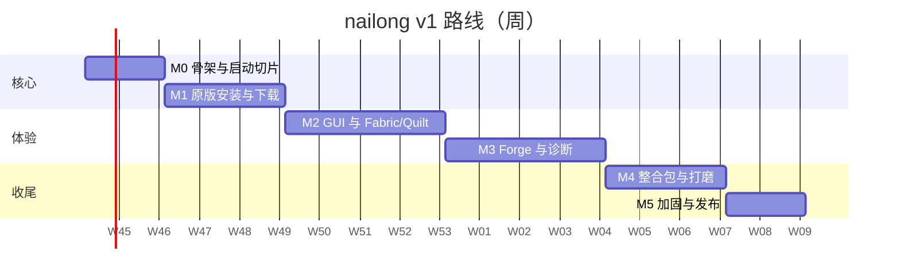

# 10 · 路线图与验收

> 估算前提：**1 名全职开发者**，每周 5 天；不含设计评审/法务/美术外包时间。
> 策略：**先打通一条垂直切片（解析 → 启动），再横向扩展安装/加载器/UI**；任何时候都保持可运行、可测试。

## 1. 里程碑总览

| 里程碑 | 主题 | 估算 | 关键产出 | 退出标准 |
|---|---|---|---|---|
| **M0** | 骨架与启动切片 | 2 周 | workspace、模型、解析、Java 探测、CLI 启动 | 用已有 `.minecraft` 启动 1.20.1 与 26.3；参数快照通过 |
| **M1** | 原版安装与下载 | 3 周 | 下载器、镜像、原版安装、资源、JRE、校验/修复 | 空目录安装并离线启动；中断可续 |
| **M2** | GUI 与 Fabric/Quilt | 4 周 | egui 外壳、向导、实例管理、设置、Fabric/Quilt | 三步安装并启动 Fabric；体积/内存达标 |
| **M3** | Forge/NeoForge 与诊断 | 4 周 | 原生 processors、离线账户、日志/崩溃 | Forge 1.20.1/1.21.1 可装可启动；离线账户可用 |
| **M3.5** | 正版登录（可选） | 1–2 周 | 微软 OAuth、钥匙串、刷新 | client id 获批后启用；不阻塞 v1.0 |
| **M4** | 整合包与打磨 | 3 周 | mrpack/CurseForge/MMC 导入、i18n、自动更新、macOS | 三类整合包导入可玩；中英双语 |
| **M5** | 加固与发布 | 2 周 | 安全测试、跨平台、文档、签名、发布 | 验收清单全绿 |

**合计约 18 周**（含缓冲；M3.5 不计入关键路径）。若每周只能投入 2–3 天，按比例延长到 8–12 个月。



> 日期仅示意，从立项日顺延；不要对外承诺具体发布日期。

## 2. M0 · 骨架与启动切片（2 周）

### 目标

证明"我们能正确解析并启动一个已安装的 Minecraft"，不写 GUI、不写下载器。

### 任务

1. Cargo workspace、`rust-toolchain.toml`、CI（fmt/clippy/test/deny）。
2. `paths` / `config` / `error` / `progress` / 日志初始化。
3. `model`：VersionJson、Library、Rule、Arguments、Instance。
4. `resolve`：继承链、合并、规则（os/arch/features/versionRange）、classpath、参数。
5. `launch::java`：探测 + 选择；`launch::plan`：LaunchPlan；`launch::exec`：spawn + 日志。
6. CLI：`nailong list`、`nailong launch <instance> --print-plan`。
7. 夹具：1.7.10 / 1.12.2 / 1.20.1 / 1.21.11 / 26.3 的真实 JSON（裁剪）。
8. 假 Java 测试：argv 快照、natives 解压、取消。
9. UI 技术验证（可与上述并行）：最小 eframe 窗口，测体积/内存/首帧/中文/IME。

### 验收

- [ ] 在已有 `.minecraft` 上，用系统 Java 启动 1.20.1 原版，进入主菜单。
- [ ] 启动 26.3（Java 25）成功，natives 解压到 `<natives>/java`。
- [ ] `--print-plan` 与 HMCL/Prism 的实际命令对比，classpath 与关键参数一致（允许顺序差异）。
- [ ] 1.7.10 旧参数、1.12.2 Forge 的 `--tweakClass` 正确。
- [ ] 中文路径下启动成功（或明确记录旧版 LWJGL 限制与规避）。
- [ ] 单元测试覆盖合并/规则/参数；CI 绿。

## 3. M1 · 原版安装与下载（3 周）

### 目标

从空目录安装任意正式版并启动；断网可启动已安装版本。

### 任务

1. `net`：reqwest 客户端、候选 URL、重试/退避、ETag、Range 续传、原子写、并发闸门。
2. 镜像规则（BMCLAPI + 自定义）+ 地区启发式 + 失败回退。
3. 版本清单/版本 JSON 缓存与校验。
4. 原版安装：client jar、libraries、asset index、assets（对象/虚拟）、logging。
5. 托管 JRE：Mojang 运行时清单、lzma/raw、执行位、暂存目录、原子提交。
6. `verify` / `repair`；安装锁；磁盘空间检查。
7. CLI：`install <mc>`、`verify`、`repair`、`java list/install`。
8. mock HTTP 测试：候选切换、续传、416、哈希失败、zip 安全。

### 验收

- [ ] 空目录安装 1.20.1，启动成功；安装 26.3 成功。
- [ ] 断网后启动已安装实例（不检查更新、不发请求）。
- [ ] 下载中断后重跑，续传/跳过已完成文件，最终哈希正确。
- [ ] 移除一个 library 后 `repair` 只补该文件。
- [ ] 镜像切换生效（日志显示候选顺序）。
- [ ] 安装过程取消，无残留"已完成"标记；再次安装可继续。

## 4. M2 · GUI 与 Fabric/Quilt（4 周）

### 目标

普通用户可三步安装 Fabric 并启动；视觉/交互达到可发布的最低标准。

### 任务

1. UI 外壳：侧边栏、页面路由、主题、字体、i18n 骨架、toast/modal。
2. 首次启动、主页、实例卡片、新建向导、实例详情、设置、下载中心。
3. 事件/命令桥；进度合并；取消/重试。
4. Fabric/Quilt 安装器（profile JSON + 库）。
5. Java 管理 UI（检测列表、下载、选择）。
6. 图标/头像（2D）、空状态、错误卡。
7. Windows/Linux 打包脚本；体积/内存基准进 CI。
8. UI 原型评审（低保真 → 高保真）。

### 验收

- [ ] 全新用户：打开 → 新建 → 选 1.21.11 + Fabric → 安装 → 启动，≤ 3 次点击（不含等待）。
- [ ] Windows x64 exe ≤ 15 MB；空闲 RSS ≤ 120 MB；首帧 ≤ 400 ms。
- [ ] 下载 64 个文件时 UI 仍可交互，帧率 ≥ 55 FPS。
- [ ] 中文实例名、中文路径、中文输入法正常。
- [ ] 取消安装/启动有明确反馈；错误有可操作按钮。
- [ ] 浅色/深色截图通过设计评审。

## 5. M3 · Forge/NeoForge 与诊断（4 周）

### 目标

覆盖主流模组加载器与离线账户；崩溃可诊断。正版登录拆到 M3.5（可选）。

### 任务

1. Forge 新格式 processors：解析、data 变量、临时 client.jar、outputs 跳过、哈希校验、取消。
2. Forge 旧格式（≤1.12.2）、NeoForge（含 1.20.1 兼容）。
3. 外部 installer 兜底（显式选择）+ 日志。
4. 离线账户、账户抽象、账户 UI（正版登录入口占位/隐藏）。
5. 日志窗口、退出分类、崩溃报告、诊断信息复制。
6. 真实 Forge/NeoForge 集成测试（夜间，允许网络）。

> **正版登录不在 M3**：client id 与 allowlist 就绪后走 M3.5。M3 只交付离线账户与账户抽象，避免外部审批阻塞 Forge/发布。

### M3.5 · 正版登录（可选，1–2 周）

- 微软 OAuth（PKCE loopback + 设备码）、Xbox 链路、entitlements/profile。
- 钥匙串存储、刷新、脱敏。
- **前置条件**：client id 已获 Minecraft Services allowlist；未获批则只保留代码与测试，不启用 UI。

### 验收

- [ ] Forge 1.20.1（47.x）从零安装并启动，无缺失库。
- [ ] Forge 1.21.1 或 NeoForge 21.1.x 安装并启动。
- [ ] 安装中断/processor 失败时，不污染已有版本；错误可读。
- [ ] 离线账户可创建/切换；账户抽象为后续正版登录留好接口。
- [ ] （M3.5，若已获批）微软登录成功；令牌不出现在日志/导出脚本/崩溃窗口。
- [ ] 退出码 0/1/崩溃/JVM 错误分类正确。

## 6. M4 · 整合包与打磨（3 周）

### 目标

"下载整合包 → 导入 → 开玩"闭环；英文可用；可更新。

### 任务

1. mrpack 导入（文件哈希、overrides、env）。
2. CurseForge 导入（API key、限流、可选文件）。
3. MultiMC/Prism 实例导入（mmc-pack、instance.cfg、overrides）。
4. 覆盖策略与安全（路径、zip bomb）。
5. 英文翻译、文案评审；日期/数字格式。
6. 自动更新（签名清单）+ 关于页。
7. macOS `.app` 构建（未公证）。
8. 模组列表（启用/禁用/删除/打开文件夹）；导出 v1.1。
9. 性能与内存优化；图标/头像缓存。

### 验收

- [ ] 导入 3 种格式各一个真实整合包，启动成功。
- [ ] 恶意 zip（路径穿越/炸弹）被拒绝，UI 解释原因。
- [ ] 英文界面无截断/硬编码中文。
- [ ] 自动更新可检测/下载/校验；签名错误拒绝。
- [ ] macOS 可启动（Gatekeeper 说明）。

## 7. M5 · 加固与发布（2 周）

### 任务

1. 安全测试补齐（路径、SSRF、重定向、权限）。
2. 跨平台冒烟（Win10/11、Ubuntu 22.04/24.04、macOS 13+）。
3. 文档：用户手册、FAQ、故障排查、构建说明。
4. 发布流水线：版本号、CHANGELOG、产物哈希、签名。
5. 崩溃/错误上报（可选、默认关闭）。
6. 代码冻结、回归、发布候选。

### 验收

- [ ] 验收清单（§10）全绿。
- [ ] 三个平台安装包可用；Windows 无 VC 运行库依赖。
- [ ] 冷启动/内存/体积达标。
- [ ] 安全清单（09 §11）通过。
- [ ] 许可证/NOTICE/字体许可齐全。

## 8. 关键路径与并行

```text
M0 模型/解析 ──► M1 下载/安装 ──► M2 GUI ──► M3 Forge/账户 ──► M4 整合包 ──► M5 发布
       │                  │             │
       └─ UI 原型（并行）  └─ 基准（并行） └─ 英文翻译（并行）
```

- **最长路径**：Forge processors（M3）。如果它延期，先发布"M2 + Fabric/Quilt + 原版"的 0.x，Forge 作为 0.y。
- 可并行的独立工作：UI 设计/原型、i18n、文档、打包脚本、测试夹具。
- 不建议并行修改 `resolve`/`launch` 核心（冲突高）。

## 9. 风险登记

| # | 风险 | 概率 | 影响 | 缓解 | 触发信号 |
|---|---|---|---|---|---|
| R1 | Forge processors 兼容性 | 高 | 高 | 先做 1.20.1 单版本；每个 processor 独立测试；外部 installer 兜底；预留 2 周缓冲 | 连续 3 个版本失败 |
| R2 | 微软 client id 未获 Minecraft Services allowlist | 高 | 中（已延期） | v1.0 不做正版登录；client id 可配置；不盗用他人 id；M3.5 再启用 | `login_with_xbox` 返回 403 Invalid app registration |
| R3 | egui 中文 IME/视觉不达标 | 中 | 中 | M0 原型验证；备选 iced；core 无关 | 输入重复/候选窗错位 |
| R4 | 新 MC 版本格式变化（26.x） | 中 | 中 | 一切数据驱动；夜间端点测试；附录 A 记录 | 新版本启动失败 |
| R5 | 镜像/端点失效 | 中 | 中 | 多候选 + 官方回退 + 可配置 | 夜间检查失败 |
| R6 | 体积/内存超预算 | 中 | 中 | CI 预算；尽早测量；裁剪依赖 | exe > 15 MB |
| R7 | 误用 PCL 受限代码 | 中 | 高 | 许可证已定 GPLv3；Prism/HMCL 可移植；PCL 只研究行为、不复制 | 代码来源审查发现 PCL 片段 |
| R8 | 范围蔓延（模组浏览/服务器管理） | 高 | 中 | 明确非目标；feature gate；v2 再说 | 需求列表膨胀 |
| R9 | Windows 旧版 LWJGL 中文路径 | 中 | 中 | ASCII natives 临时目录；文档；JLW 评估 | 用户崩溃报告 |
| R10 | CurseForge API key 限制 | 中 | 低 | 可选用户 key / 构建时内置；无 key 走官方下载页；作者限制停止导入 | API 403/限流 |
| R11 | 单人开发进度 | 高 | 中 | 里程碑可独立发布；0.x 先行 | 连续两周无进度 |
| R12 | macOS 公证/签名成本 | 高 | 低 | 未公证说明；后续购买 | 用户无法打开 |
| R13 | 许可证义务未履行 | 低 | 高 | 发布前检查 LICENSE/NOTICE/源码提供 | 发布审核 |

## 10. v1.0 验收清单

### 功能

- [ ] 安装/启动原版 1.7.10、1.12.2、1.20.1、1.21.11、26.3。
- [ ] Fabric/Quilt/Forge/NeoForge 各至少一个版本。
- [ ] 离线账户 + 账户抽象；正版登录作为 M3.5（若 client id 获批）。
- [ ] mrpack/CurseForge/MultiMC 导入。
- [ ] 校验/修复/取消/续传。
- [ ] 镜像切换与自定义。
- [ ] 实例隔离/共享目录。
- [ ] 崩溃报告与日志。

### 质量

- [ ] 无 P0/P1 缺陷。
- [ ] 单元/集成测试覆盖核心解析、下载、认证、Forge 变量。
- [ ] 三平台冒烟通过。
- [ ] 安全清单通过。
- [ ] 体积/内存/启动达标。
- [ ] 中文/英文完整；无硬编码。

### 发布

- [ ] 版本号/CHANGELOG/哈希/签名。
- [ ] 许可证与第三方 NOTICE。
- [ ] 用户文档与故障排查。
- [ ] 回滚方案。

## 11. 立项后两周的具体动作

1. **决策**：平台优先级、数据目录默认位置；许可证已定 GPLv3；client id 暂缓。
2. `cargo new` workspace；提交 CI 与 `cargo-deny`。
3. 下载并归档测试夹具（5 个版本 JSON + Fabric/Forge/NeoForge）。
4. 实现 `model` + `resolve` + 规则引擎；用 1.20.1 做第一个快照测试。
5. 实现 Java 探测 + `LaunchPlan` + 假 Java 测试。
6. 在已有 `.minecraft` 上跑通 1.20.1 启动。
7. 并行：最小 eframe 窗口 + 中文输入测试 + 体积/内存基准。
8. 写 M0 复盘：哪些假设错了，更新设计文档。

## 12. 待决策（需要产品负责人）

| # | 问题 | 建议 | 影响 |
|---|---|---|---|
| Q1 | 许可证 | ~~GPL-3.0-or-later~~ **已定** | 可移植 GPL 代码；依赖需兼容 GPLv3 |
| Q2 | 首发平台 | Windows x64 + Linux x64 | 测试/打包范围 |
| Q3 | Azure client id + Minecraft Services 审批 | **暂缓**；v1.0 不阻塞，M3.5 再启用 | 正版登录上线时间 |
| Q4 | 图标/插画素材 | 原创或合规来源 | 视觉素材来源 |
| Q5 | CurseForge | 可选：用户 key、环境变量或构建时内置默认 key | 整合包体验 |
| Q6 | 遥测 | 默认关闭 | 隐私/运营 |
| Q7 | 自动更新渠道 | GitHub Releases + 签名 | 分发/国内访问 |
| Q8 | 模组浏览 | 不做（v1） | 范围 |
| Q9 | 最低 MC 版本 | 1.7.10 | 旧版兼容成本 |
| Q10 | 是否开源 | ~~建议~~ **已定开源（GPLv3）** | 社区/贡献 |
