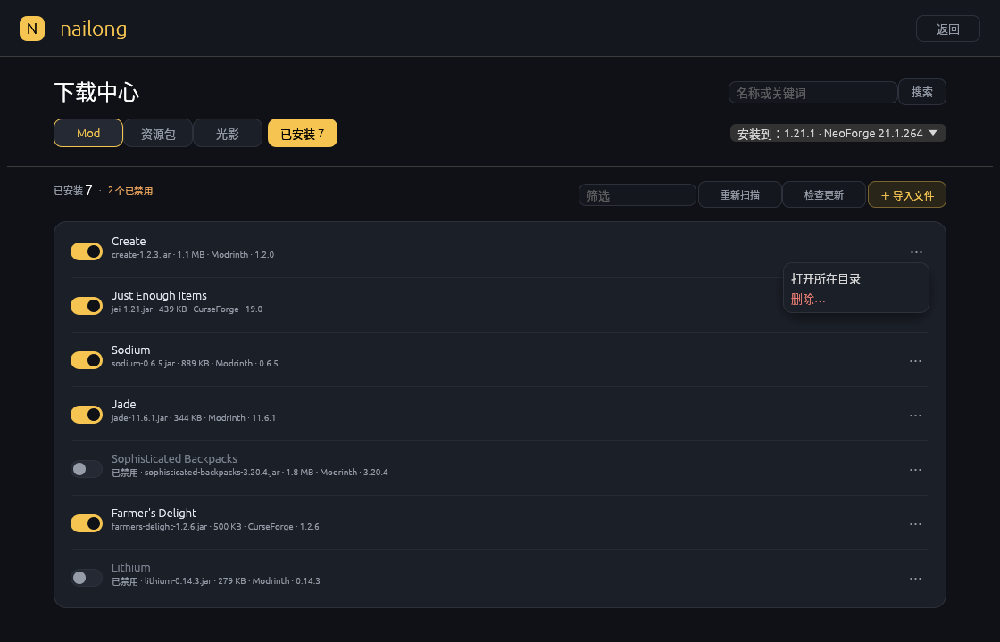

# 15 · 界面设计系统（0.16）

> 适用于 `crates/nailong-ui` 的实际实现。设计目标：**信息密度高、层级清楚、只有一个主操作、不用嵌套滚动**；深色为唯一主题。

## 1. 原则

1. **一屏一件事**：每个页面只有一个暖黄色主按钮；其余操作退成描边、幽灵按钮或文字链接。
2. **不空转**：卡片按内容收紧，列表行固定高度；没有内容的区域交给空状态，而不是铺一张大卡片。
3. **单滚动**：页面只有内容区滚动；标题、搜索、类型、安装目标固定在顶部。
4. **状态可见**：扫描、检查更新、解析前置、登录等待都有 spinner + 一句人话；成功/失败就地显示，不弹系统框。
5. **危险操作二次确认**：删除单行内容、快照、版本都走内联确认，红字只出现在确认态。
6. **中文优先**：字号、断行、标点按中文排版；英文只作为产品名、加载器和文件名的补充。

## 2. 色板

| Token | 色值 | 用途 |
|---|---|---|
| `BG` | `#0F1116` | 窗口底色 |
| `PANEL` | `#14171D` | 侧栏、工具条、输入框、次级面板 |
| `CARD` / `SURFACE` | `#1B1F27` | 卡片、列表容器、弹窗 |
| `SURFACE2` | `#242933` | 选中行、悬停、标签底 |
| `LINE` | `#2C313C` | 1px 描边、分隔线 |
| `ACCENT` | `#F5C451` | 主按钮、选中态、开关键、可更新 |
| `MUTED` | `#949BA7` | 次级说明、元数据 |
| `OK` / `SUCCESS` | `#7EC699` | 成功、“已安装”、启用状态 |
| `WARN` | `#E8A15C` | 可恢复的警告、缺文件、Banner |
| `DANGER` | `#E27A70` | 删除确认、错误 |

补充文本色：正文 `#E4E8F0`，说明 `#C6CBD5`，弱化 `#747B88`。

原则：**一个强调色**。黄色只给主操作、当前选中和“有新版本”；成功用绿色，错误用红色，不用第二品牌色。

## 3. 字号

| 层级 | 字号 | 字重 | 例子 |
|---|---:|---|---|
| 页面标题 | 22–24 | strong | 下载中心、安装游戏 |
| 页面副标题 | 10–11 | regular / muted | 选择 Minecraft 版本和加载器 |
| 区块标题 | 13 | strong | 版本信息、前置与依赖、热门 |
| 卡片标题 | 13.5–14 | strong | 项目名、版本名 |
| 列表主行 | 12–13 | strong | 已安装项目名、世界名 |
| 正文 | 11–12 | regular | 摘要、说明 |
| 元数据 | 9–10.5 | regular / muted | 文件名、大小、下载量、日期 |
| 标签 | 9 | regular | 必需、可选、优化 |

不使用字号小于 9 的文本；超过两行的说明在卡片里截断，完整内容放详情页。

## 4. 间距与圆角

- 间距基数：2 / 4 / 6 / 8 / 10 / 12 / 14 / 16 / 18 / 20 / 22 / 24 / 28 / 30。
- 页面左右内边距：28 px；内容最大宽度 1000 px，居中。
- 顶部工具条：64 px 高；页面内固定头部用 `Panel::top`，上下 14–16 px。
- 圆角：输入框/小按钮 8，卡片 12–14，弹窗 16，胶囊 14，开关 10。
- 卡片内边距 16–20；列表容器内边距 4–6；列表行高 52–58。

## 5. 布局

```text
┌ Top bar 64 ─────────────────────────────────────────────┐
│ logo                                  页面级按钮 / 返回 │
├ Panel::top（固定）──────────────────────────────────────┤
│ 标题 + 搜索 / 类型标签 / 安装目标 / 筛选                │
├ CentralPanel + 单个 ScrollArea ─────────────────────────┤
│ 内容（最多 1000px 居中）                                │
│  · 浏览：品类胶囊 + 热门/最新卡片                        │
│  · 详情：Hero + 版本信息/前置 + 版本记录                 │
│  · 内容管理：工具条 + 更新横幅 + 行列表                  │
│  · 存档：世界侧栏 288px + 快照列表                       │
└─────────────────────────────────────────────────────────┘
```

- 窗口默认 1120×720，最小 900×620；所有页面在 900 宽下不横向溢出。
- 主界面双栏：≥980 时 604 + 20 + 剩余；更窄时左栏自动收缩，右栏保持 300。
- 安装页双栏：1000 宽时 588 + 20 + 剩余；更窄时左栏收到 `width - 350`，四个加载器磁贴按可用宽度等分。
- 项目卡片网格：≥960 四列、≥820 三列、否则两列；卡片高 112，间距 10。
- 详情页：Hero 内“信息 + 安装面板（322）”；下方 632 + 12 + 356。
- 不使用嵌套滚动；表格/版本列表超长时整页滚动，或用下拉选择器收敛。

## 6. 组件

### 主按钮
暖黄底、黑字、13.5 px strong、高 40、圆角 9。每个视图最多一个（安装 / 启动 / 登录 / 立即快照）。

### 描边按钮
暗黄底 `#292519` + ACCENT 文字 + 暗黄描边，高 30；“导入文件”“全部更新”“重新打开浏览器”。
### 幽灵按钮
PANEL 底 + LINE 描边 + MUTED 文字，高 30；用于返回、次级操作。
### 文字链接
透明底、10.5 px MUTED；用于“打开目录”“复制”“或导入本地文件”。

### 输入框
PANEL 底、LINE 描边、圆角 8、内边距 8×4；占位文字 MUTED。搜索框右侧保留“搜索”按钮，回车等价。

### 标签
- 品类胶囊：圆角 14，选中为暗黄底 + ACCENT 描边。
- 信息标签：圆角 5，9 px；必需/可更新用暗黄，不兼容用暗红，其余 SURFACE2。
- 状态点：4 px 圆点；绿色=正常，橙色=需注意。

### 开关
36×20 圆角胶囊，120 ms 动画；开=ACCENT 底 + BG 圆点，关=SURFACE2 底 + 灰圆点；悬停提示“点击禁用/启用”。

### 卡片
CARD 底、LINE 描边、圆角 12–14、内边距 16–20；悬停时描边变 ACCENT。卡片不铺满整行，宽度由网格决定。

### 列表行
52–58 高，悬停铺 SURFACE2；行间用 `#262B34` 1px 线；右侧操作使用 24 高小按钮或 `⋯` 菜单。

### 弹窗
`egui::Modal` + 黑色 100 alpha 遮罩 + CARD 圆角 16；标题 18–20，说明 10.5 MUTED；底部右侧主操作，左侧放退出登录等次级危险操作。

### 空状态
标题 15–16 strong、一句下一步说明、一个主按钮；可选一条文字链接。存档空状态额外显示仓库占用、数据块数和备份策略。

### 更新横幅
暗黄底 `#262217` + 暗黄描边，左侧向上箭头，标题“N 项有新版本”，右侧“全部更新”；行内更新用 52×24 的“可更新”标签。

## 7. 反馈与状态

| 状态 | 表现 |
|---|---|
| 扫描/检查更新 | 行内 spinner + “检查版本更新…”，完成后绿色一句“检查完成，3 个可更新” |
| 解析前置 | 安装按钮文案暂时变为“解析前置…”并禁用 |
| 空目录 | 卡片空状态 + “浏览 Mod / 导入文件” |
| 筛选无结果 | “没有匹配「xxx」的内容” + “清除筛选” |
| 删除 | 行内变为“取消 / 确认删除”，确认后才写盘 |
| 更新中的禁用项 | 更新后保持禁用，不会悄悄启用 |
| 失败 | 红色一行错误，保留当前页面和已输入内容 |

## 8. 截图

全部截图在 Xvfb 1120×720 下截取，脚本与调试入口见 `crates/nailong-ui/src/main.rs` 的 `NAILONG_DEBUG_*`。

| 页面 | 截图 |
|---|---|
| 启动台 |  |
| 版本管理 |  |
| 安装游戏 |  |
| 下载中心 · 浏览 |  |
| 下载中心 · 搜索 |  |
| 项目详情 |  |
| 内容管理 |  |
| 更新横幅 |  |
| 空内容 |  |
| 空存档 |  |
| 快照列表 |  |
| 安装进度 |  |
| 账户弹窗 |  |
| 登录弹窗 |  |
| 行操作菜单 |  |
| 删除确认 |  |

## 9. 调试入口（仅 debug 构建）

| 变量 | 作用 |
|---|---|
| `NAILONG_DEBUG_SCREEN=install\|manage\|mods\|saves\|installed\|progress\|account\|login` | 直接进入页面/状态 |
| `NAILONG_DEBUG_SELECT=<id 子串>` | 选中一个版本 |
| `NAILONG_DEBUG_PROJECT=<关键词>` | 搜索并打开第一个项目的详情 |
| `NAILONG_DEBUG_SEARCH=<关键词>` | 直接执行搜索 |
| `NAILONG_DEBUG_SIZE=900x620` | 以指定内尺寸启动，用于窄窗口检查 |
| `NAILONG_DEBUG_OPEN_MODS` / `NAILONG_DEBUG_OPEN_SAVES` | 旧入口，保留兼容 |

截图流程：`Xvfb :99` → 启动 debug 二进制 → `import -window root` → 裁掉窗口外区域（1120×720 时偏移 140,90）。
