# 15 · 界面设计系统（0.18.1）

> 适用于 `crates/nailong-ui` 的实际实现。目标：**玩家视角的信息架构、黄橙白浅色主题、每件事只有一个入口、每个页面只有一个主操作**。

## 1. 原则

1. **一个地方管一件事**：启动台负责开始游戏，版本负责安装/修复/删除，内容负责 Mod/资源包/光影（发现和已安装同页），存档负责世界与快照。四个入口常驻侧边栏，不再层层钻取。
2. **没有“回退到上一个管理页”**：一级页面之间是平级切换；只有安装页、项目详情、搜索结果这类明确的子流程才提供局部返回，返回目标写在按钮上（如「‹ 版本」）。
3. **一屏一件事**：每个页面只有一个暖橙色主按钮；其余操作用描边、幽灵按钮或文字链接。
4. **单滚动**：页面只有内容区滚动；标题、模式、类型、安装目标固定在顶部。
5. **状态可见**：扫描、检查更新、解析前置、登录等待都有 spinner + 一句人话；成功/失败就地显示，不弹系统框。
6. **危险操作二次确认**：删除内容、快照、版本都走内联确认，红色只出现在确认态。
7. **中文优先**：字号、断行、标点按中文排版；英文只作为产品名、加载器和文件名的补充。

## 2. 色板

| Token | 色值 | 用途 |
|---|---|---|
| `BG` | `#FFF9F0` | 窗口底色（奶油白） |
| `PANEL` | `#FFFCF6` | 侧边栏、次级面板、输入框 |
| `CARD` / `SURFACE` | `#FFFFFF` | 卡片、列表容器、弹窗 |
| `SURFACE2` | `#FFF2E0` | 选中行、悬停、标签底、当前侧边栏入口 |
| `LINE` | `#F0E0CB` | 1px 描边、分隔线 |
| `ACCENT` | `#F59E0B` | 主按钮、选中态、开关键、可更新 |
| `ACCENT_HI` | `#FFC75A` | 主按钮渐变亮端、焦点光 |
| `ACCENT_LO` | `#F08A1C` | 主按钮渐变暗端、描边 |
| `ACCENT_TEXT` | `#A65E0A` | 浅黄底上的强调文字，保证对比度 |
| `INK` | `#2E2418` | 正文与深色文字（暖黑） |
| `MUTED` | `#8B7A66` | 次级说明、元数据 |
| `OK` / `SUCCESS` | `#2F8F5B` | 成功、“已安装”、启用状态 |
| `WARN` | `#BE6E0F` | 可恢复的警告、缺文件、Banner |
| `DANGER` | `#C0392B` | 删除确认、错误 |

原则：**白卡片 + 奶油底 + 橙色强调**。黄色只给主操作、当前选中和“有新版本”；成功用绿色，错误用红色，不用第二种品牌色。浅黄底上的小字使用 `ACCENT_TEXT`，不用纯 `ACCENT`，避免在白底上发飘。

## 3. 字号

| 层级 | 字号 | 字重 | 例子 |
|---|---:|---|---|
| 页面标题 | 22–26 | strong | 内容、存档、安装游戏 |
| 页面副标题 | 10–11 | regular / muted | Mod、资源包、光影 · 已安装与发现 |
| 区块标题 | 11–13 | strong | 最近内容、安装信息、热门 |
| 卡片标题 | 12.5–14 | strong | 项目名、版本名 |
| 列表主行 | 12–13 | strong | 已安装项目名、世界名 |
| 正文 | 11–12 | regular | 摘要、说明 |
| 元数据 | 8.5–10.5 | regular / muted | 文件名、大小、下载量、日期 |
| 标签 | 9 | regular | 必需、可选、优化 |

不使用字号小于 8 的文本；超过两行的说明在卡片里截断，完整内容放详情页。

字重不是“把颜色调深”：正文用系统常规字重，标题、主按钮、列表主行单独注册一个 `bold` 字体族（Linux 用 Noto Sans CJK Bold，Windows 用微软雅黑 Bold，macOS 用 PingFang 的粗体面），通过 `RichText::family(bold_family())` 使用。没有粗体字体时回退到常规字体，而不是用伪粗体或描边模拟。

## 4. 间距与圆角

- 间距基数：2 / 4 / 6 / 8 / 10 / 12 / 14 / 16 / 18 / 20 / 22 / 24 / 28 / 30。
- 页面左右内边距：28 px；内容最大宽度 1000 px，居中。
- 侧边栏内边距：宽栏 14 px，窄栏 10 px；顶部 18，底部 14。
- 圆角：输入框/小按钮 8，卡片 12–14，弹窗 16，胶囊 14，侧边栏入口 10，开关 10。
- 卡片内边距 16–20；列表容器内边距 4–6；列表行高 52–58。

## 5. 信息架构

```text
启动台   启动游戏、当前版本概览、账户、最近内容、最近存档
版本     版本列表、安装信息、启动/补全/打开目录/删除、安装新版本
内容     同一个库的两种模式：已安装 / 发现；类型：Mod / 资源包 / 光影
存档     版本选择器 + 世界列表 + 快照（创建/恢复/删除/全部备份）
```

- 侧边栏是唯一的一级导航；没有顶部导航条，也没有“版本管理 → 内容/存档”的二级入口。
- 安装页属于「版本」的子流程，左上角「‹ 版本」返回版本页；没有版本时返回「‹ 启动台」。
- 项目详情、搜索结果属于「内容」的子流程，返回后保留原来的列表、筛选和搜索词。
- 存档页自身的版本选择器只切换存档上下文，不跳回版本页；当前版本同时同步到侧边栏卡片。
- 没有版本时启动台显示欢迎空状态，而不是把安装表单塞满整页；首次启动仍直接进入安装页。

## 6. 布局

```text
┌ 侧边栏 204 ┬ 内容区（最大 1000，居中）────────────────────┐
│ logo        │ 页面标题 + 模式/搜索/安装目标                  │
│ 当前版本卡  │ ───────────────────────────────────────────── │
│ 启动台      │ 单个 ScrollArea                               │
│ 版本        │  · 启动台：主卡 + 账户 / 最近内容 + 存档        │
│ 内容        │  · 内容：模式行 + 筛选 + 卡片/行列表           │
│ 存档        │  · 存档：世界侧栏 288 + 快照列表                │
│ 账户 / 版本 │                                               │
└─────────────┴───────────────────────────────────────────────┘
```

- 窗口默认 1120×720，最小 900×620；所有页面在 900 宽下不横向溢出。
- 侧边栏：窗口宽 ≥1080 时为 204 px 文字栏；更窄自动变成 76 px 图标栏（rail），图标带 tooltip。
- 启动台双栏：内容宽度 ≥860 时左栏优先 604、右栏 300（左栏至少 480）；更窄时两栏各让一步，右栏保持 ≥280。状态环定位在卡片矩形内，不依赖内容流。
- 安装页双栏：1000 宽时 588 + 20 + 剩余；更窄时左栏收到 `width - 350`，四个加载器磁贴按可用宽度等分。
- 版本页：左栏 292；标题与操作在 ≥800 时同一行，窄窗口把「启动 / 打开目录」换到标题下一行，标题用 `truncate` 截断。
- 内容页：标题行放「安装到」下拉；发现模式再放搜索框。模式行是「已安装 / 发现」+ 类型胶囊。卡片网格 ≥960 四列、≥820 三列、否则两列，卡片高 112，间距 10。
- 存档页：世界侧栏 288；标题 + 版本选择器在左，自动备份/保留份数/备份全部/清理旧快照在右；内容宽度 <840 时控制条换到下一行。
- 项目详情：Hero 内“信息 + 安装面板（322）”；下方 632 + 12 + 356。
- 不使用嵌套滚动；长列表整页滚动，或用下拉选择器收敛。

## 7. 组件

### 侧边栏入口
44 px 高、圆角 10；图标 17–19 px 线性绘制（房子 / 层叠列表 / 2×2 网格 / 书签），宽栏带 13 px 文字。选中：`SURFACE2` 底 + 1 px 暖黄描边 + 左侧 3 px 橙色竖条 + 右侧橙色圆点；悬停：`#FFF7EA`。任务进行中或登录中整组导航禁用，颜色降到暖灰，不改变布局。

### 当前版本卡
宽栏顶部 66 px 卡片：状态点 +「当前版本」、版本名（截断）、`MC · 加载器`。点击进入版本页；没有版本时显示「还没有版本 / 点击安装」。窄栏隐藏此卡。

### 主按钮
不是“黄橙渐变胶囊”，而是一块有厚度的琥珀色：

- 填充：`#F7B23A → #EF9B1A` 的窄渐变（明度差控制在 10% 内），悬停只提亮 4%，不用大范围高光。
- 边缘：1 px `#D88510` 描边；内侧顶部 1 px 暖白高光（alpha 38），底部 2 px 深棕内阴影（alpha 18），只保留“被压出来”的厚度，不做塑料光泽。
- 投影：两层暖棕阴影——`0 1 2` 的接触阴影 + `0 7 20` 的环境阴影；悬停时抬高 1 px、阴影略微扩散，按下时下沉 1 px、阴影收紧。
- 文字：真粗体、`INK`，光学中心下移 0.5 px；主行动可带 15 px 线性图标（播放 / 下载），图标与文字作为整体居中，不单独贴边。
- 尺寸：高 40（紧凑 30–34），圆角 `height × 0.24`（8–10）；宽度至少 72，内容居中并至少留 12 px 呼吸。
- 禁用：`#F8EEE0` 底 + `LINE` 描边 + 暖灰粗体字，尺寸不变，避免布局跳动。


### 次按钮
白底、`#E7D3B8` 1 px 描边、`0 2 7` 的极浅暖棕投影；悬停底色变 `#FFF8EC`、描边转 `ACCENT_HI`，按下底色转 `SURFACE2` 并下沉 0.5 px。文字用常规字重和 `INK`，不抢主按钮。用于「内容管理」「打开目录」「重新扫描」「检查更新」「选择文件」以及分页/返回等次级动作。

### 状态环
当前版本卡右下角 22 px（窄卡 15 px）的 300° 环：完整时绿色 + “√ / 就绪”，缺文件时橙色 + “! / 缺 N 项”；底环使用 `#ECE1D2`，外圈有一层极淡的同色光。

### 页面标题
标题左侧 3 px 橙色渐变竖条 + 7–8 px 空隙；用于内容、存档、安装游戏、版本名。副标题紧随其下，10–11 px `MUTED`。

### 内容模式
- 「已安装 / 发现」是两个 32 px 高的胶囊：选中为 `ACCENT` 底 + `INK` 字，未选为白底 + `MUTED` 字；已安装带数量。
- 类型「Mod / 资源包 / 光影」是次级选择：选中为 `SURFACE2` 底 + `ACCENT_TEXT` 字 + `ACCENT` 描边；未选为白底 + `LINE`。
- 来源/品类胶囊：圆角 14，选中 `#FFF1D6` 底 + `ACCENT` 描边。

### 描边按钮
白底 + `LINE` 描边 + `MUTED` 文字，高 30；用于导入文件、重新扫描、检查更新、返回。
### 文字链接
透明底、10.5 px `MUTED`；用于“打开目录”“复制”“或导入本地文件”。
### 危险文字按钮
默认是白底 + `LINE` 的 30 px 按钮，文字 `DANGER`；确认态改为 `#FFE2DC` 底 + `DANGER` 描边/文字，不把整行染红。

### 输入框
白底、`LINE` 描边、圆角 8、内边距 8×4；占位文字 `MUTED`。搜索框右侧保留“搜索”按钮，回车等价。

### 标签
- 信息标签：圆角 5，9 px；必需用 `#FFF3D6` 底 + `ACCENT_TEXT`，不兼容用 `#FFE2DC` 底 + `DANGER`，其余 `SURFACE2` + `MUTED`。
- 状态点：4 px 圆点；绿色=正常，橙色=需注意。

### 开关
36×20 圆角胶囊，120 ms 动画；开=ACCENT 底 + BG 圆点，关=`#C9B8A2` 底 + 白圆点；悬停提示“点击禁用/启用”。

### 卡片
白底、`LINE` 描边、圆角 12–14、内边距 16–20；默认带 38 px 模糊的暖棕投影。悬停时整体上抬 3 px、描边渐变为 `ACCENT`，底色渐变为 `#FFF5E4`，并叠加一层暖橙柔光；卡片不铺满整行，宽度由网格决定。

### 列表行
52–58 高，悬停铺 `#FFF7EA`；行间 1 px `LINE`；右侧操作使用 24 高小按钮或 `⋯` 菜单。禁用行整体降到 `#A08F7B`，开关仍在。

### 弹窗
`egui::Modal` + 暖黑遮罩（`#2E2418`，约 28% alpha）+ 白卡圆角 16；200 ms 内从 0.35 透明度、下移 8 px 进入；标题 18–20，说明 10.5 `MUTED`；底部右侧主操作，左侧放退出登录等次级危险操作。

### 空状态
白卡、标题 15–17 strong、一句下一步说明、一个主按钮；可选一条文字链接。启动台欢迎页用于“一个版本都没有”，存档空状态提示进游戏创建世界，内容空状态直接给「去发现」。

### 更新横幅
`#FFF4D6` 底 + 暖黄描边，左侧向上箭头，标题“N 项有新版本”，右侧「全部更新」；行内更新用 26 px 高的「可更新」描边小按钮。

## 8. 动效与光感

所有动画都服务于层级和状态，不做无意义的循环位移。

| 场景 | 时长 | 实现 |
|---|---:|---|
| 页面切换 | 260 ms | 内容下移 10 px + 奶油色遮罩淡出（0.26 后完全透明） |
| 卡片 hover | 160 ms | 上抬 3 px、描边/底色渐变、暖橙外光 |
| 主按钮呼吸 | 5 s 周期 | 外发光 alpha 8–14，hover 额外 +28；按下内缩 1 px |
| 开关 | 120 ms | 滑块横向缓动，轨道颜色渐变 |
| 进度条 | 300 ms 平滑 + 5 s 扫光 | 数值用 `animate_value` 追平；橙黄渐变填充 + 填充内白色扫光 |
| 弹窗入场 | 200 ms | 遮罩、边框、内容透明度与 8 px 位移一起进入 |
| 环境光 | 15 fps | 奶油→浅橙竖向渐变、44 px 点阵、左上暖橙/右下浅橙径向光、12 颗缓慢上浮的橙色微光粒子 |
| 健康状态环 | 静态 | 300° 圆弧 + 中心符号 + 状态色 |

- 动画只在窗口聚焦或动画进行时请求重绘；空闲时不空转。
- 所有循环都是低频、低幅度：微光 alpha ≤ 14，粒子 alpha ≤ 19，避免“网吧灯效”。
- 900×620 下动效降级为同一套参数，不做额外横向滚动。

## 9. 反馈与状态

| 状态 | 表现 |
|---|---|
| 扫描/检查更新 | 行内 spinner + “检查版本更新…”，完成后绿色一句“检查完成，3 个可更新” |
| 解析前置 | 安装按钮文案暂时变为“解析前置…”并禁用 |
| 空目录 | 卡片空状态 + “去发现 Mod / 导入文件” |
| 筛选无结果 | “没有匹配「xxx」的内容” + “清除筛选” |
| 删除 | 行内变为“取消 / 确认删除”，确认后才写盘 |
| 更新中的禁用项 | 更新后保持禁用，不会悄悄启用 |
| 下载任务 | 侧边栏底部显示 spinner + “任务进行中”，导航禁用；进度页保留取消 |
| 失败 | 红色一行错误，保留当前页面和已输入内容 |

## 10. 截图

全部截图在 Xvfb 1120×720 下截取，900×620 单独一张；窗口偏移分别为 140,90 与 250,140。调试入口见第 11 节。


| 页面 | 截图 |
|---|---|
| 启动台 | 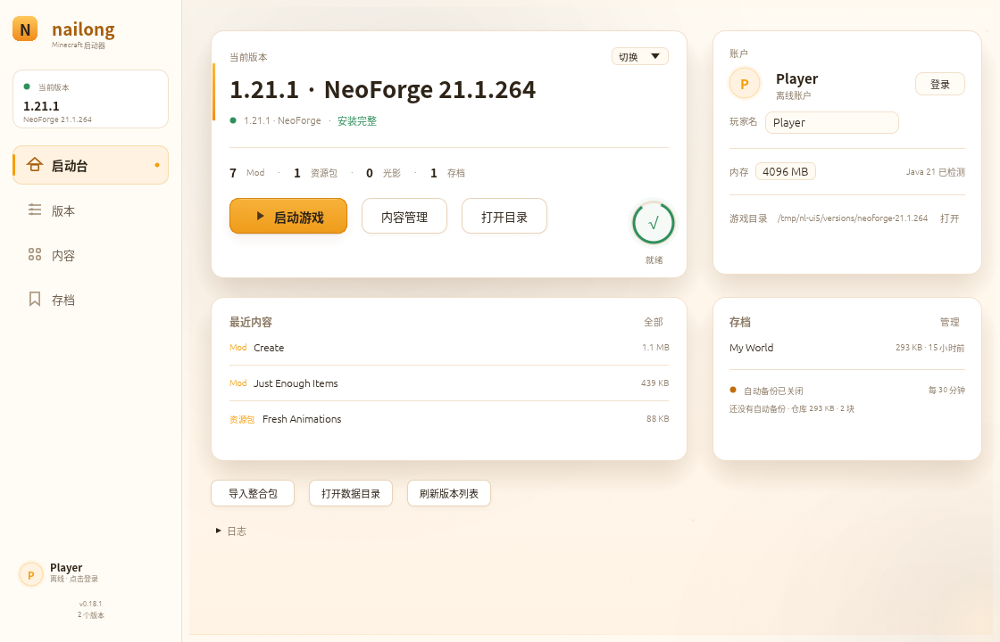 |
| 版本 | 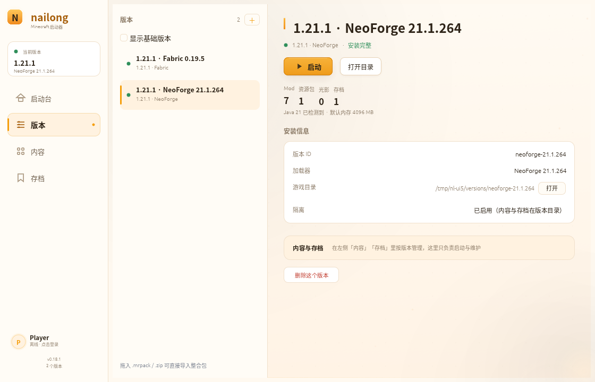 |
| 安装游戏 |  |
| 内容 · 发现 | 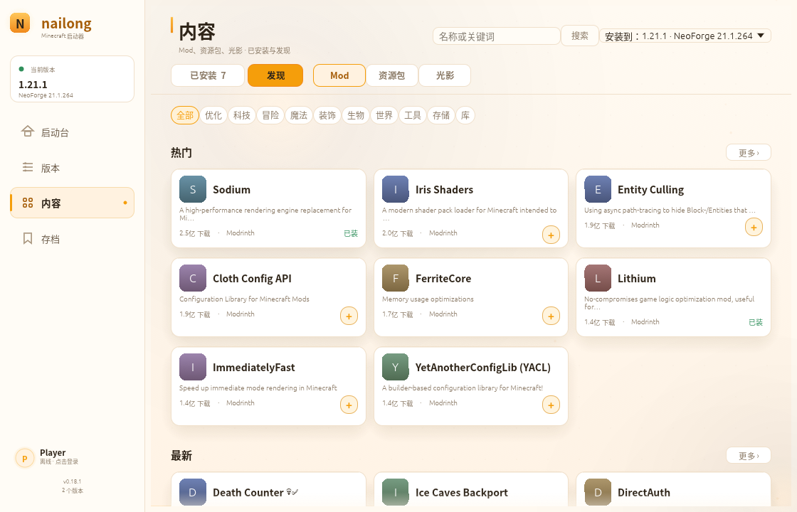 |
| 内容 · 搜索 | 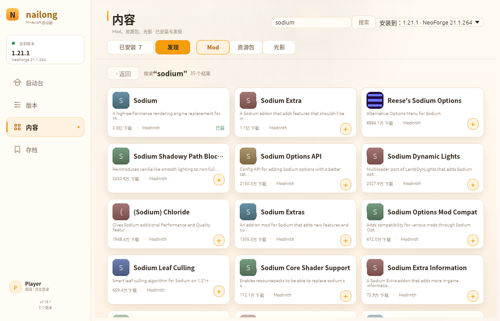 |
| 内容详情 |  |
| 内容 · 已安装 | 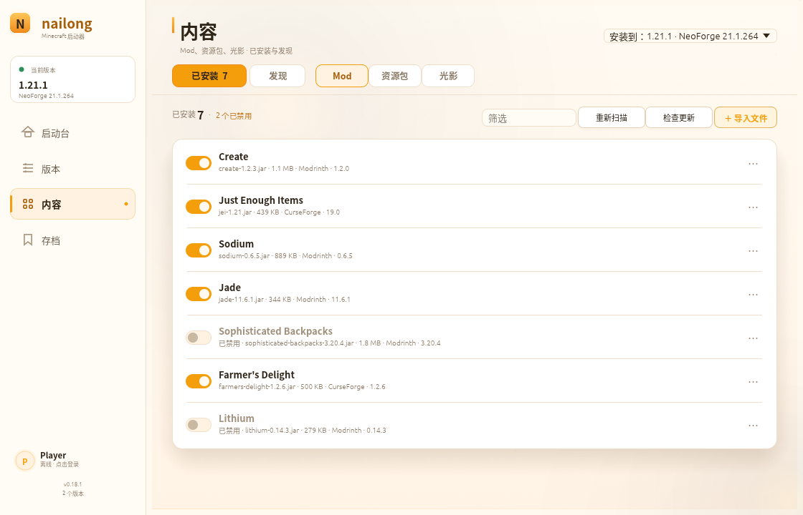 |
| 更新横幅 | 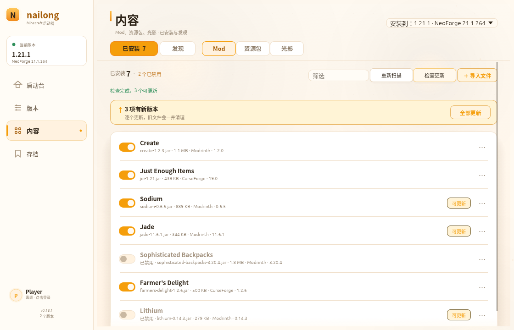 |
| 空内容 |  |
| 空存档 |  |
| 快照列表 | 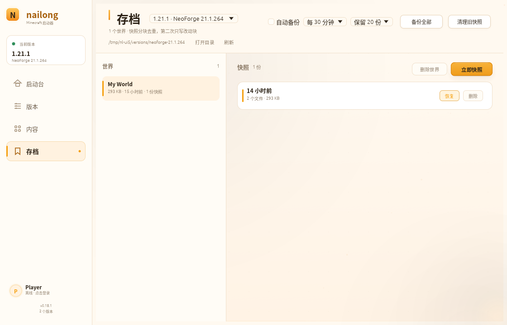 |
| 安装进度 | 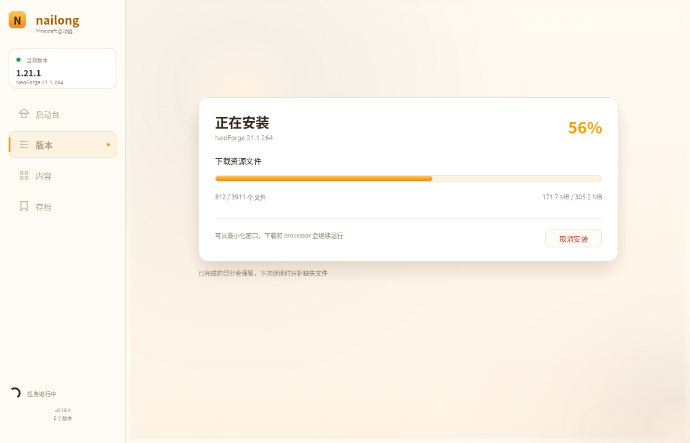 |
| 账户弹窗 | 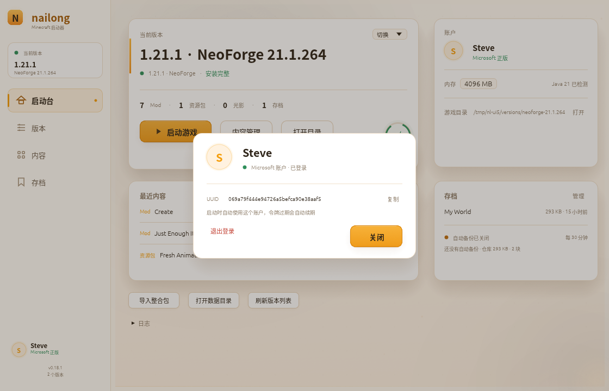 |
| 登录弹窗 | 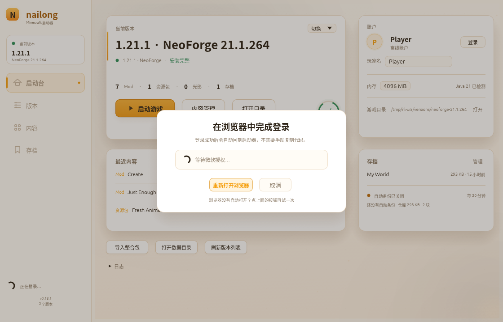 |
| 首次启动欢迎页 |  |
| 删除确认 | 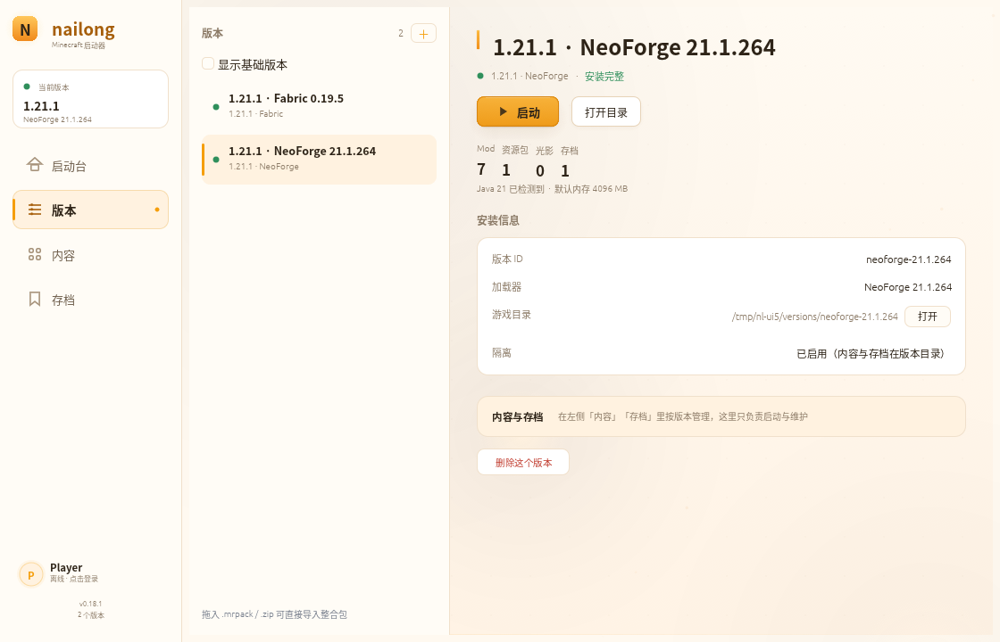 |
| 内容 · 资源包 | 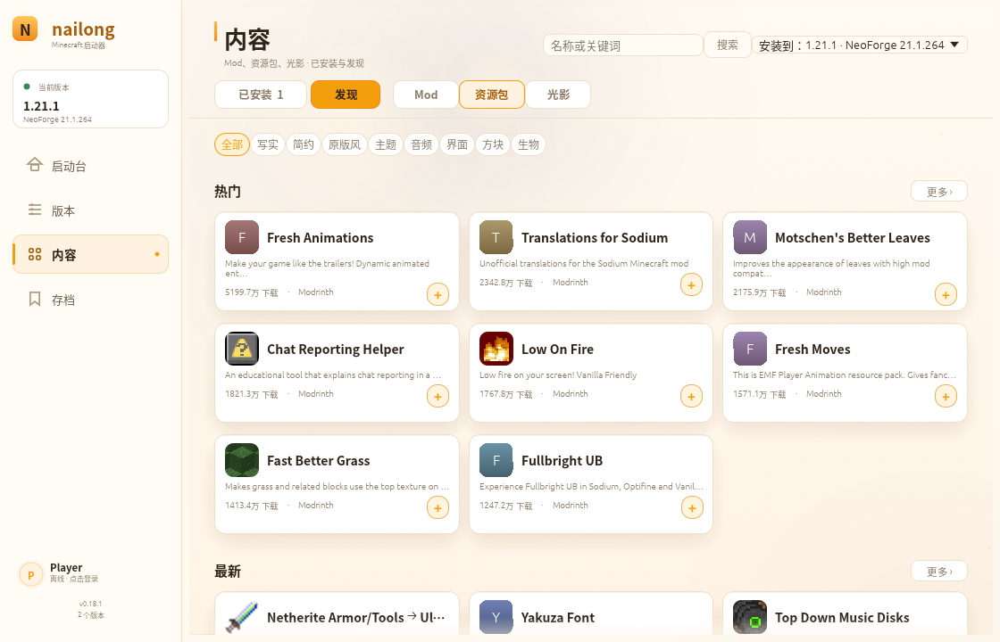 |
| 900×620 最小窗口 | 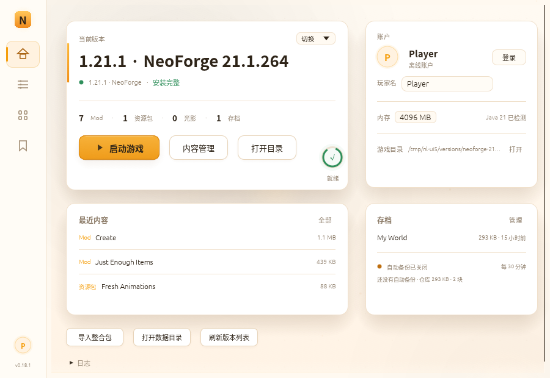 |

按钮细节前后对比：[button-detail.png](../screenshots/button-detail.png)。

## 11. 调试入口（仅 debug 构建）

| 变量 | 作用 |
|---|---|
| `NAILONG_DEBUG_SCREEN=install\|manage\|mods\|saves\|installed\|progress\|account\|login\|welcome` | 直接进入页面/状态 |
| `NAILONG_DEBUG_SELECT=<id 子串>` | 选中一个版本 |
| `NAILONG_DEBUG_PROJECT=<关键词>` | 搜索并打开第一个项目的详情 |
| `NAILONG_DEBUG_SEARCH=<关键词>` | 直接执行搜索 |
| `NAILONG_DEBUG_SIZE=900x620` | 以指定内尺寸启动，用于窄窗口检查 |
| `NAILONG_DEBUG_HOVER=<名称子串>` | 强制某张项目卡保持 hover，便于截图 |
| `NAILONG_DEBUG_HOVER_CYCLE=<N>` | 让前 N 张卡按 1.35 s 节奏依次 hover，用于录屏 |
| `NAILONG_DEBUG_OPEN_MODS` / `NAILONG_DEBUG_OPEN_SAVES` | 旧入口，保留兼容 |

截图流程：`Xvfb :99` → 启动 debug 二进制 → `import -window root` → 裁掉窗口外区域。录屏用 `ffmpeg -f x11grab`，再转 840×540 / 10 fps / 112 色 GIF。
